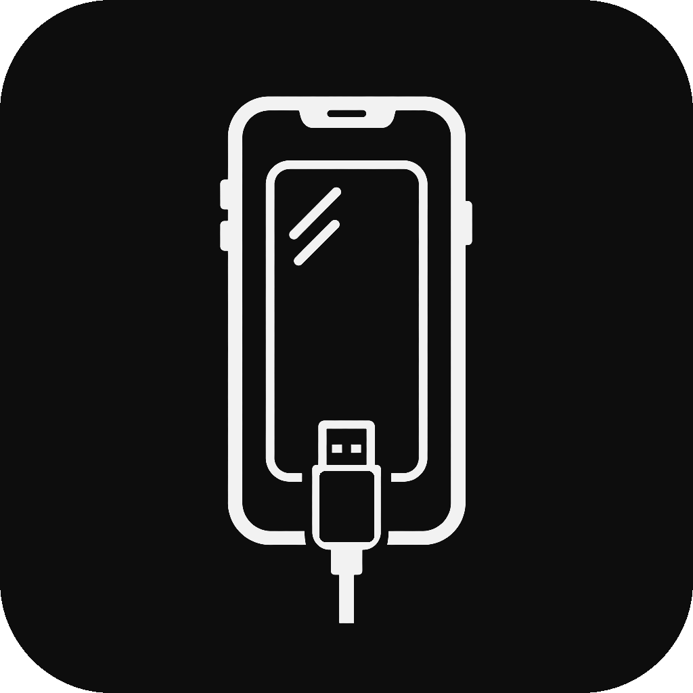

<p align="center">
  
</p>

<h1 align="center">iPhoneMirror</h1>

<p align="center">
  Windows 向けの低遅延な iPhone 画面・システム音声ミラーリング。<br>
  USB での直接キャプチャと無線 AirPlay の受信を 1 つのアプリで。
</p>

<p align="center"><a href="README.md">简体中文</a> · <a href="README.en.md">English</a> · <strong>日本語</strong></p>

<p align="center">
  <a href="https://github.com/RayrenSX/iPhoneMirror/releases"></a>
  <a href="https://github.com/RayrenSX/iPhoneMirror/actions/workflows/windows-build.yml"></a>
  <a href="LICENSE"></a>
  
</p>

> [!IMPORTANT]
> これはパブリックプレビューで、商用の Authenticode 署名はされていないため、Windows
> が SmartScreen や不明な発行元の警告を表示することがあります。Apple Screen Capture は
> 非公開プロトコルを使うため、将来の iOS バージョンでは更新が必要になる場合があります。公式ビルドは
> 現在 Windows x64 のみに対応しています。USB カーネルドライバーと無線ランタイムが ARM64 向けに
> 用意されていないため、Windows ARM64 には対応していません。

## コミュニティによる移植と謝辞

iPhoneMirror をより多くのプラットフォームに届けてくれているコミュニティの開発者の皆さんに感謝します！
以下の移植版は、それぞれの作者が独自に保守しています。ぜひ
フォローし、試し、彼らの活動を応援してください。

| プラットフォーム | コントリビューター | 移植の重点 | プロジェクトとドキュメント |
|---|---|---|---|
| **Linux** | **[@furruka](https://github.com/furruka)** | ネイティブの Linux UI、音声／映像、デバイスとの通信 | [リポジトリ](https://github.com/furruka/iPhoneMirror) · [移植ノート](https://github.com/furruka/iPhoneMirror/blob/linux-port/docs/LINUX_PORT.md) |
| **HarmonyOS (PC)** | **[@zhangziqizZ](https://github.com/zhangziqizZ)**<br>Bilibili: **@Fantasy_zzq** | HarmonyOS NEXT / 2in1 向けの、ネイティブの音声／映像による USB と AirPlay のミラーリング | [リポジトリ](https://github.com/zhangziqizZ/iPhoneMirror) · [移植ノート](https://github.com/zhangziqizZ/iPhoneMirror/blob/main/docs/移植说明.md) |

対応機能、リリースパッケージ、ビルド手順、既知の制限については、
各プロジェクトの README と移植ノートを参照してください。

## 最近の開発状況

現在の main のプロジェクトバージョンは **1.8.5-pre5** です。ツールバーのドラッグによる並べ替え、表示項目とアイコンのみの表示設定、独立ウィンドウの透明度・最前面表示を切り替えるショートカット（押すたびに切替／押している間のみ適用）を追加しました。実験的な Bluetooth 絶対位置マウスは既定で無効です。設定はアプリ、ミラーリング、逆操作の3分類を維持し、Automation API のスクリーンショット要求上限は毎秒1～30回に設定できます。[pre5 の更新内容](docs/releases/v1.8.5-pre5.md)も参照してください。

中国語 IME 使用時のキーボード転送、ショートカットの解放とフォーカスの復帰、クリップボードのタイムアウトからの復帰、初回起動時のモード下書きも改善しています。Windows の IME の変換候補テキストは、スマートフォンに自動では同期されません。確定したテキストをコピーし、プレビュー上で Ctrl+V を押して送信してください。

[ユーザーガイド](docs/USER_GUIDE.md)、[IME の検証範囲](docs/SOGOU_IME_VERIFICATION_2026-10-31.zh-CN.md)、[変更履歴](CHANGELOG.md)を参照してください。main の変更は、新しいインストーラーが公開されたことを意味しません。

## ダウンロード

`iPhoneMirror-Setup-v*-x64.exe` を
[Releases](https://github.com/RayrenSX/iPhoneMirror/releases) からダウンロードしてください。3 言語対応の
セットアップウィザードでは、インストール先を指定できます。管理者としてインストールする場合のデフォルトは
`C:\Program Files\iPhoneMirror` で、スタートメニューの
項目を作成し、デスクトップショートカットも任意で作成できます。ユーザー単位のインストールでは
Windows のユーザープログラム用ディレクトリを使います。ポータブルで使う場合は、
`iPhoneMirror-v*-win-x64.zip` をダウンロードして完全に展開し、
`iPhoneMirror.exe` を実行します。Windows が無線用の DLL について **不正なイメージ** または `0xc0e90002` を
報告した場合は、セットアップを使ってください。ポータブルでの利用が必要な場合は、ダウンロードした
ZIP のプロパティを開いて **許可する** を選び、もう一度展開してください。展開済みの DLL を 1 つだけ
許可しても十分ではありません。

どちらのパッケージも自己完結型で、単体の
`iPhoneMirror.Driver.exe` ドライバー管理ツールを含みます。.NET
Desktop Runtime やドライバーツールを別途ダウンロードする必要はありません。ダウンロードしたファイルは、同じ Release の
`SHA256SUMS.txt` アセットで検証してください。

デフォルトでは、アプリは起動後に GitHub Releases を確認します。アップデートが
ある場合は、バージョン、公開日、Markdown のリリースノートを表示します。
**今すぐアップデート** を押すと、ダウンロードと検証を行ってその場でのアップグレードを起動し、
アプリを再起動します。情報ページでは、手動での確認、安定版／ベータ版の
チャネル設定、自動ダウンロードも利用できます。アプリのテーマは、メインウィンドウの
アプリの設定で変更できます。ネットワークの障害やタイムアウトで、通常の
起動が妨げられることはありません。

[完全なユーザーガイド（中国語）](docs/USER_GUIDE.md)では、主要な画面と操作の流れをすべて説明しています。

ソースレベルの詳細については、[ドキュメント索引](docs/README.md)、[開発・テストガイド](docs/DEVELOPMENT.md)、
[アーキテクチャ](docs/ARCHITECTURE.md)を参照してください（中国語）。

コンピューターには Apple の USB サポートが必要です。ない場合、ドライバー管理ツールはまず
信頼できるローカルの `AppleMobileDeviceSupport64.msi` を使い、次に Apple の Software Update カタログから
単体の MSI をダウンロードし、最後に
公式の署名付きデスクトップ版 iTunes パッケージにフォールバックして、その Apple Mobile Device
Support コンポーネントを取り出します。Microsoft Store の Apple Devices も、引き続き手動の
選択肢としてサポートしています。このプロジェクトは Apple のバイナリを再配布しません。無線の検出には
Windows 10/11 に組み込まれた DNS-SD サポートを使い、Bonjour はインストールしません。
検出自体には管理者権限は不要です。管理者としてのセットアップでは、
`iPhoneMirror Wireless AirPlay` というローカルサブネット用のファイアウォール規則を追加します。この規則は
`WirelessHost.exe` とローカルサブネットに限定されますが、
AirPlay のセッションごとにネゴシエートされる TCP/UDP のメディアポートは許可します。アンインストール時に削除されます。
ポータブルパッケージは、ファイアウォールを自動では変更しません。

## プロジェクトの説明

iPhoneMirror は、Windows 10/11 x64 向けのローカルな iPhone/iPad ミラーリングツールです。
有線の USB キャプチャとローカルネットワークでの AirPlay 受信を、1 つのセッション、
プレビュー、音声、スクリーンショット、独立ウィンドウ、OBS、複数デバイスのワークフローにまとめ、
クラウド中継は使いません。

このプロジェクトには、明確な 4 つの境界があります。C++ コアは Apple の非公開
USB プロトコル、QuickTime/CoreMedia の解析、H.264 のデコード、D3D11 による描画、
WASAPI の音声を担当します。WPF アプリはデバイスの検出、セッションの制御、UI を担当します。そして
分離された無線ホストは AirPlay のプロトコルとデコードを担当し、サイズに上限のあるメディア
フレームを名前付きパイプで送ります。ドライバーのインストール、修復、削除は
単体の `iPhoneMirror.Driver.exe` が担当します。メインアプリは有線ドライバーの
状態を読むだけで、キャプチャプロセスの中でシステムドライバーを変更することはありません。

> [!TIP]
> ドライバーのセットアップ、USB、AirPlay、複数デバイスのプレビュー、OBS、ログ、詳細設定については、
> [完全なユーザーガイド](docs/USER_GUIDE.md)を参照してください。

## 主な特長

### iPhone と iPad の機種ごとの表示

iPhoneMirror は、すべてのデバイスを同じ汎用の角丸
長方形に収めるわけではありません。Apple の `ProductType` を解決して、iPhone X、
ノッチ付きの機種、mini、標準／Max、Dynamic Island、iPad Pro、Air、mini、
オールスクリーンの無印 iPad 向けの表示プロファイルを選びます。ホームボタン付きや長方形の画面として知られている機種は
長方形のままです。未知の将来のデバイスには控えめな形状のフォールバックを使うため、
iPad がスマートフォン形の曲線で切り取られることはありません。

このプロファイルは、ネイティブの描画と独立ウィンドウの輪郭の両方に反映されます。
サイズ変更、画面の向きの変更、フルスクリーンへの切り替えでもそのデバイスの見た目の
形が保たれます。また、コンテキストメニューから角の丸みを手動で外したり
戻したりすることもできます。
角のパラメーターは、公開されているデバイスの外観とフレームの
形状に基づいて見た目を合わせたもので、Apple が公表している工業的な寸法ではありません。

### 統一された転送、ネイティブ描画、複数デバイス

- USB の Screen Capture とローカルネットワークの AirPlay で、デバイス、プレビュー、音声、OBS のワークフローを共有します。
- スマートフォンごとに独自のセッションと独立ウィンドウがあり、複数のデバイスを同時に動かし続けられます。
- デバイスカードは長押しで並べ替えでき、新しい無線の送信元は 1 回だけ自動で選択されます。
- H.264/CoreMedia と AirPlay の画面ミラーリングのフレームはローカルでデコードされ、D3D11/DirectComposition で表示されます。
- メディアは iPhoneMirror のクラウド中継を通らず、USB キャプチャはネットワークに依存しません。
- すっきりした独立ウィンドウはそのまま OBS で使え、スクリーンショットはアプリの UI を含まないデコード済みフレームから取得します。
- iOS の AssistiveTouch を通じた BLE HID のマウス／キーボード操作にオプションで対応し、スマートフォン側のアプリや脱獄は不要です。

### 一般的なミラーリングツールとの比較

| 観点 | iPhoneMirror | 一般的な汎用のアプローチ |
|---|---|---|
| 接続 | USB と AirPlay を 1 つのワークフローで | 1 種類の転送のみ、または有線と無線で別々のアプリ |
| デバイスの形 | iPhone/iPad の系統ごとの曲線と角 | 汎用の角丸 1 種類、長方形、または余分な黒枠 |
| 複数デバイス | 独立したセッション、ウィンドウ、並び順、同時プレビュー | 主に 1 台ずつの切り替え |
| 有線の互換性 | デバイスごとのデモ、実験的な AirPlay、Aisi モード | 固定のネゴシエーションパラメーター |
| OBS | すっきりしたネイティブの独立ウィンドウ | 操作 UI を切り抜くか、デスクトップをキャプチャ |
| ドライバー | デバイスごとの個別のインストール、修復、削除、ログ | ドライバーの変更がメインアプリの中に隠れている |
| データの経路 | ローカルの PC/LAN で処理し、プロジェクトのクラウド中継なし | アカウントやオンラインサービスが必要な製品もある |

iPhoneMirror のオプションの Bluetooth 操作は、BLE HID と iOS の AssistiveTouch を使います。
ポインター型の入力に限られ、マルチタッチのイベントは送れません。この
プロジェクトには動画編集機能は組み込まれていません。Apple の非公開プロトコルと互換の
AirPlay 実装は、将来の iOS リリースで更新が必要になる場合があります。

## 機能

| 分野 | 実装 |
|---|---|
| 有線キャプチャ | デバイスごとのデモ、実験的な AirPlay、Aisi 互換モードによる USB 直接キャプチャ |
| 無線キャプチャ | ローカルネットワークの AirPlay を、メインのプレビューとすべての出力機能に統合 |
| 動画アプリからのキャスト | AirPlay/DLNA の HTTP(S)/HLS 再生、操作、ソースの音声 |
| 映像 | CoreMedia/AVCC の H.264、HEVC の記述の解析、Media Foundation の自動／ハードウェア／ソフトウェアのポリシー |
| 描画 | フルレンジ BT.709 のメタデータ付きの、ネイティブ D3D11/DirectComposition プレビュー |
| 音声 | USB の 48 kHz PCM と AirPlay の PCM を WASAPI で再生、ミュート、音量 |
| デバイス | iPhone/iPad のメタデータ、信頼の状態、安定した更新、安全な切り替え |
| 画質 | ネイティブ／1080p／720p／540p のローカル上限と、24/30/60/120 FPS の上限 |
| プレビュー | メイン、独立、フルスクリーン、回転、縦横比の固定、デバイスに合わせた角 |
| OBS | ウィンドウキャプチャ向けの、デバイスごとのすっきりした独立ウィンドウ |
| Bluetooth 操作 | デバイスごとの BLE HID マウス／キーボードの紐付け、システムのナビゲーション、設定可能なグローバルショートカット |
| USB／無線のリモート操作 | 別の CoreDevice ブリッジ。デベロッパモード、一致する DDI、検証済みのデバイス HID サービスが必要 |
| 映像の調整 | プレビューだけに適用される明るさ、コントラスト、彩度、ガンマ |
| ツール | スクリーンショット、強制更新、ショートカット、ライブログ、簡体字中国語・繁体字中国語（香港）・英語・日本語の UI |
| ドライバー | 有線キャプチャの前にデバイスごとに厳密にチェックし、失敗した場合は単体のドライバー管理ツールを開く |

解像度と FPS の設定はローカルでの表示に上限をかけるだけで、
元の USB ストリームの画質は下げません。

USB デバイスのデフォルトは **Aデモ（推奨）** です。これは
ネイティブの `DisplaySize` とともに `Valeria=true` を通知し、スマートフォンの画面全体を保ちますが、ステータスバーの日付、
時刻、バッテリーは Apple のデモ用の値に固定されます。**B AirPlay（実験的）** は
ネイティブの寸法と画面の向きへの自動追従を使うため、動画アプリが外部
再生を使えますが、切り取られたり画面全体が収まらなかったりする場合があります。**C Aisiモード** は
ネゴシエーションを予測しやすくするために目標を 1565×1565 に固定しますが、その分ソースの
鮮明さが犠牲になります。各モードの横にある感嘆符ボタンで、それぞれのトレードオフをすべて確認できます。
選択は現在の USB デバイスだけに適用されます。

## クイックスタート

1. Release のセットアップを実行し、スタートメニューから iPhoneMirror を起動します。
   ポータブルパッケージの場合は、ZIP を完全に展開して `iPhoneMirror.exe` を実行します。
2. iPhone または iPad を USB で接続してロックを解除し、**このコンピュータを信頼** を選びます。
3. 左側のナビゲーションで **ドライバー管理** をクリックし、対象のデバイスに対して
   ワンクリックインストールを実行します。このツールは、必要に応じて不足している Apple の USB サポートとキャプチャ
   フィルターをインストールします。
4. スマートフォンを選んで **ミラーリングを開始** をクリックします。選択した有線デバイスの
   ドライバーがない、または無効な場合、アプリはその開始操作を取り消し、
   ドライバー管理ツールを自動で開きます。

別のデバイスを選ぶと、まず前のセッションに QuickTime の停止制御を送り、
通常の USB 構成に戻します。メインウィンドウを閉じたときも、
同じクリーンアップ処理が実行されます。

> [!WARNING]
> Zadig を使って Apple の親ドライバーを WinUSB/libusb に置き換えないでください。
> iPhoneMirror が同梱しているのは、アプリケーションの起動に必要な `libusb0.dll` ユーザーモード
> ランタイムだけです。カーネルのキャプチャフィルターのインストールや有効化は
> 行いません。`libusb0` の UpperFilter の変更には、別のドライバーユーティリティを使ってください。

## 有線ドライバーの管理

`iPhoneMirror.exe` はドライバーの状態を読むだけです。インストール、修復、削除は、
同じディレクトリにある単体の `iPhoneMirror.Driver.exe` が行います。
左側のナビゲーションにある **ドライバー管理** ボタンで、いつでも開けます。同じ
ツールがすでに実行中の場合は、既存のウィンドウがアクティブになります。

有線デバイスで **ミラーリングを開始** をクリックすると、アプリはキャプチャセッションを作成する前に、
現在選択しているスマートフォンについて次の点を確認します。

- Apple の USB の親が引き続き `usbccgp` を使っていること
- デバイスに `libusb0` の UpperFilter があること
- `libusb0.sys` ファイルとサービスが正常であること
- `libusb0` が該当デバイスのシリアルを列挙できること

いずれかが失敗すると、その有線での開始操作は止められ、ドライバー管理ツールが開きます。
ドライバーを修復し、求められた場合はデバイスを接続し直してから、
メインアプリに戻ってもう一度 **ミラーリングを開始** をクリックしてください。UI のログは
`%LOCALAPPDATA%\iPhoneMirror.Driver\Logs\driver-ui.log` に保存されます。管理者権限での操作のログは
`%ProgramData%\iPhoneMirror.Driver` の下に保存されます。

同梱ドライバー／外部ドライバーの完全な一覧は、
[`docs/DRIVER_DEPENDENCIES.md`](docs/DRIVER_DEPENDENCIES.md) に記載しています。

## 診断ログ

メインアプリは、マネージドの UI とワークフローのエラーを
`%LOCALAPPDATA%\iPhoneMirror\Logs\application.log` に書き込みます。USB、デコーダー、描画の
コアの診断情報は、同じ場所の `capture.log` に保存されます。起動に失敗した場合は
`startup.log` も書き込まれ、ワンクリックアップデートではタイムスタンプ付きの
`installer-update-*.log` ファイルが作られます。LocalAppData が一時的に使えない場合、
重大なマネージドのエラーは `%TEMP%\iPhoneMirror-fallback.log` に書き込まれます。

**情報 → 診断** を使うと、ログフォルダーを開いたり、ログとダウンロード済みの
アップデートパッケージをすぐに削除したりできます。ログは自動でローテーションされ、14
日より古いファイルは削除され、メインのログディレクトリの上限は 64 MB です。
使用中のファイルはスキップされ、ミラーリングは中断されません。

> [!NOTE]
> この自動チェックは、有線の USB デバイスにだけ適用されます。無線の AirPlay の
> ソースは `libusb0` を必要とせず、確認もしません。ドライバーの状態を理由に
> ドライバー管理ツールを開くこともありません。

## 無線 AirPlay

AirPlay の受信機能はメインアプリと一緒に起動します。iPhone に受信側が表示されるために、
ユーザーが **ミラーリングを開始** をクリックする必要はありません。左側のデバイス一覧に、空の
AirPlay ソースは表示されません。無線のカードは
送信元が接続したあとに作られ、接続時に 1 回だけ自動で選択されます。

1. Windows コンピューターと iPhone/iPad を同じプライベートネットワークに接続します。
2. **無線AirPlay** の欄で、受信側の名前と通知する接続プロファイルを
   設定します。
3. 最大の 5120x2880・60 fps、デフォルトの 1080p・60 fps、720p・30 fps、
   または 540p・30 fps から選びます。
4. **適用** をクリックします。名前と解像度の変更は、1 つのダイアログにまとめて表示されます。
5. iOS のコントロールセンターで画面ミラーリングを開き、設定した名前を選びます。
6. 接続中の無線セッションには **ミラーリングを停止** を使います。受信機能は動き続けます。

無線のタブには、有線用のローカルの解像度／FPS の上限は表示されません。AirPlay の画質は、
接続前に通知しておく必要があります。新しい名前やプロファイルを適用すると
受信機能が再起動し、現在の無線セッションはすべて切断されるため、スマートフォンで
もう一度受信側を選ぶ必要があります。無線の画面ミラーリングのセッションでも、
音量、スクリーンショット、独立／フルスクリーンのウィンドウ、同時プレビュー、OBS を使えます。

アプリケーションとして無線デバイスの台数に固定の上限はありません。実際に扱える数は、
CPU/GPU のリソース、メモリ、ローカルネットワークの帯域によって決まります。
同じ受信側の ID で、動画アプリからの AirPlay/DLNA のキャストも扱います。標準受信方式の RAOP TCP ポートは既定で `5001` です。設定のミラーリング分類にある無線 AirPlay で変更し、適用できます。UxPlay は独自のポート設定を使います。
固定の制御／検出用ポートは AirPlay `7001`、DLNA `8090`、SSDP `1900` です。ミラーリングと RAOP のメディアポートは、セッションごとに動的にネゴシエートされます。

管理者としてのセットアップでは、無線ホスト用に `iPhoneMirror Wireless AirPlay` というローカルサブネット用の
ファイアウォール規則を作成します。この規則はホストプロセスとローカル
サブネットに限定されますが、AirPlay の
`SETUP` 中に返される動的な TCP/UDP のメディアポートは許可します。アンインストール時に削除されます。既存のインストールで古い規則を移行するには、
この修正を含むパッケージが必要です。ポータブルパッケージは
ファイアウォールを自動では変更しません。受信する AirPlay や DLNA の接続がブロックされる場合は、
信頼できるネットワーク上で、同等のプロセス限定の規則を手動で追加してください。

送信元が接続しても画面が黒いままで、約 10 秒後に切断される場合は、
両方の規則が `LocalPort: Any` になっていて、現在の
`Wireless\iPhoneMirror.WirelessHost.exe` を指しているか確認してください。この症状は、制御用の
接続は成功したものの、ネゴシエートされたミラーリング用のポートがブロックされたことを意味します。

AirPlay の `SETUP` ハンドシェイク中に、受信側は送信元の
`deviceID`、`model`（`iPhone9,1` のような Apple の ProductType）、`osVersion` を
バイナリ plist から読み取ります。これらの値はバージョン管理された名前付きパイプの IPC を通じて
`DeviceInfo` メッセージとして渡され、選択中のデバイスのパネルに表示されます。既知の
ProductType は、元の識別子を括弧内に残したまま人が読める機種名で表示されます。
未知の識別子はそのまま表示されます。

## AirPlay での音楽のキャスト

iPhone や iPad は、画面ミラーリングを開始しなくても Windows に音楽を送れます。

1. コンピューターと iPhone/iPad を同じプライベートネットワークに置いたまま、iPhoneMirror を起動します。
2. 音楽アプリ、またはコントロールセンターの再生中パネルで AirPlay の音声ボタンをタップします。
3. 画面ミラーリングで使うのと同じ受信側の名前を選びます。
4. iPhoneMirror が無線のソースを自動で作り、PCM の音声を再生します。音量の変更、ミュート、
   セッションの停止には、メインの音声コントロールを使います。

音声だけのセッションには映像がありません。プレビューには **AirPlayミュージック** の状態が表示され、
送信元が映像を送り始めるまで、スクリーンショット、独立プレビュー、フルスクリーンのツールは
無効のままです。

## 動画アプリからのキャスト

動画アプリは同じ AirPlay の受信側の ID を使いますが、画面ミラーリングのフレームではなく
再生用の URL を送ります。アプリのキャスト／AirPlay ボタンから受信側を
選ぶと、iPhoneMirror は別の再生ウィンドウを開き、通常の
HTTP(S) の動画と HLS、再生の操作、録画、配信、仮想カメラへの
出力に対応します。DRM で保護された URL、ログインに紐付いた URL、非公開の再生 URL は、
サードパーティの受信側では使えない場合があります。

## Bluetooth によるリモート操作

iOS の AssistiveTouch を有効にし、BLE ペリフェラルモードに対応した Windows の
Bluetooth アダプターを使ってください。初回の接続時に、Bluetooth クライアントの紐付けダイアログで
該当するスマートフォンを確認します。紐付けはミラーリングするデバイスごとに保存され、
設定から削除できます。ショートカットウィンドウでは、Bluetooth、有線、
無線の操作、コントロールセンター、通知センター、Appスイッチャー、ホーム、ボス
キー、音量、ロック画面、Dock、Siri の操作を設定します。F12 は予約済みです。F1-F11 と
マウスの右／中ボタンは直接割り当てられます。
割り当てのない操作は無効のままで、重複する割り当ては拒否されます。`Backspace`
または `Delete` で割り当てを消せます。Bluetooth 操作のデフォルトのキーは `F9`、
デフォルトのボスキーは `Ctrl+Alt+B` です。

有線と無線のリモート操作には、同梱の `iUsbBridge.exe` を使います。有線の
操作には、ロックが解除された信頼済みのデバイスと、求められた場合はデベロッパモードが必要です。
一致する Developer Disk Image は、初回使用時に GitHub の公式
メタデータから解決・検証されます。無線の操作には、ペアリングとローカルネットワークでの
到達性が必要です。初回の USB または AirPlay 接続時にはデバイスプロファイルの案内が開き、
両方の ID を同じスマートフォンに関連付けられます。

## サードパーティの依存関係とライセンス

| 依存関係 | 用途 | ライセンス／ソース |
|---|---|---|
| .NET 10, WPF, Windows SDK | UI、Windows API、公開用ランタイム | Microsoft の公式ランタイム |
| libusb 1.0.29 | オプションの USB 転送互換レイヤー | LGPL-2.1-or-later、`third_party/libusb/` |
| libusb-win32 1.2.6.0 | 単体の管理ツールが使う `libusb0` フィルタードライバー | LGPL-3.0 と上流の条件、`src/DriverInstaller/Assets/` |
| AirPlayServer 1.1.2 | 無線 AirPlay、FairPlay、映像と音声のデコード | GPL-3.0、LGPL-2.1-or-later と上流の条件、`third_party/airplay-server/` |
| FFmpeg 63b2b0f47d runtime | 元の AirPlay 受信側の ABI を保つ、コンパクトな H.264/ALAC ランタイム | LGPL-2.1-or-later、ソースとビルドレシピはこのリポジトリに記録 |
| FFmpeg 8.1.2 runtime | 録画、ライブ出力、HLS のメディアキャストのブリッジ | GPL-3.0、デフォルトで `tools/ffmpeg/` に同梱 |
| iUsbBridge | USB／無線の CoreDevice リモート操作ブリッジ | [iUsbBridge](https://github.com/RayrenSX/iUsbBridge) の非商用ライセンス。レシピと USBMux のソースの境界については[コンポーネントの通知](docs/USB_TOUCH_THIRD_PARTY_LICENSES.md)を参照 |
| quicktime_video_hack fixtures | QuickTime プロトコルの回帰テスト用データ | MIT、テストフィクスチャのみ |

Apple Devices、Apple Mobile Device Support、iTunes、Windows のシステム
コンポーネントは外部の前提条件であり、このプロジェクトでは
再配布しません。著作権、ソース、バージョン、ハッシュ、ライセンスの
詳細については、[`THIRD_PARTY_NOTICES.md`](THIRD_PARTY_NOTICES.md) と
AirPlayServer の `SOURCE.md` を参照してください。

## OBS

USB と AirPlay のどちらでも独立プレビューを開き、OBS のウィンドウキャプチャで
その iPhoneMirror のウィンドウを選びます。Windows 11 では Windows Graphics Capture をおすすめします。
[OBS_OUTPUT.md](docs/OBS_OUTPUT.md) を参照してください。

## 動作確認済みのデバイス

| ProductType / iOS | ネイティブのフレーム | 実測結果 |
|---|---:|---|
| `iPhone18,3` / iOS 26.5.2 | 1206×2622 | 約 58.6 FPS、デコードは通常 3〜5 ms、48 kHz ステレオ PCM |
| `iPhone13,1` / iOS 18.7.8 | 1082×2340 | 約 58.9 FPS、デコードは通常 3〜6 ms、48 kHz ステレオ PCM |

これらはテスト済みの組み合わせであり、すべての iPhone や iOS のビルドで動作を保証するものではありません。

## ソースからのビルド

必要なもの：Windows 10/11 x64、MSVC・Windows SDK・CMake を含む Visual Studio 2026 Build Tools、
Windows Desktop をサポートする .NET 10 SDK、そしてオプションの UxPlay コンポーネント用に、
CMake、Ninja、UCRT64 ツールチェーン、GStreamer（base, good, bad, libav）、
libplist、OpenSSL を含む MSYS2 UCRT64。コンパクトな FFmpeg のビルドには、さらに
x264、Opus、SRT、oneVPL、AMF/NVENC のヘッダー、nasm が必要です。パッケージの完全な一覧は Windows のワークフローを
参照してください。USB ブリッジのビルドには Python 3.13 x64 を使います。

ビルドでは、このリポジトリの `tools/usb_touch_bridge.py` と `tools/iostouch` を
`scripts/usb-bridge-recipe` を使ってパッケージ化します。最新の上流のバックエンドをクローンすることはありません。
`IPHONE_MIRROR_USB_BRIDGE_ROOT` で、互換のレシピのディレクトリを上書きできます。
固定されたレシピの[ソースの記録](scripts/usb-bridge-recipe/SOURCE.md)を参照してください。

```powershell
git clone https://github.com/RayrenSX/iPhoneMirror.git
cd iPhoneMirror
./build.ps1 -Configuration Release
```

このスクリプトは C++20 のコアをビルドし、プロトコルのテストを実行して、
自己完結型の WPF アプリケーションを `outputs/iPhoneMirror` の下に公開します。次のものが含まれます。

```text
outputs/iPhoneMirror/iPhoneMirror.exe
outputs/iPhoneMirror/iPhoneMirror.Driver.exe
outputs/iPhoneMirror/iPhoneMirror.Core.dll
outputs/iPhoneMirror/iUsbBridge.exe
outputs/iPhoneMirror/iUsbBridge.runtime.json
outputs/iPhoneMirror/_internal/
outputs/iPhoneMirror/iPhoneMirror.VirtualCamera.dll
outputs/iPhoneMirror/iPhoneMirror.VirtualCamera.Admin.exe
outputs/iPhoneMirror/tools/ffmpeg/ffmpeg.exe
outputs/iPhoneMirror/Wireless/iPhoneMirror.WirelessHost.exe
outputs/components/iPhoneMirror-UxPlay-v<version>-win-x64.zip
```

`outputs/iPhoneMirror` は、.NET/WPF の依存関係を実行ファイルの中に同梱した
ポータブル版のビルドです。インストーラーは `outputs/iPhoneMirror.Installer` を使い、
そこではアプリが外部のランタイム DLL を使い、ドライバーは独立して
自己完結型のままです。ソリッド圧縮により、インストーラー内で重複するランタイムのデータを減らしています。

デフォルトのビルドには、録画、メディアソースの音声、RTMP/SRT/WHIP の配信に対応した
完全な FFmpeg 8.1.2 essentials ランタイムが同梱されます。カスタムのコンパクトなプロファイルは、
音声の互換性テストで既存のデコーダーの欠落が見つかったため取り下げました。
UxPlay は別のオプションのコンポーネントで、初めて選んだときに
ミラーからダウンロードされます。進行状況と速度のダイアログで、キャンセルと
再試行ができます。オフライン用のバンドルには `-IncludeUxPlayRuntime` を使います。動作するコンポーネントは、
100 MB というサイズ目標より優先されます。FFmpeg を省くのは、メディア出力が
不要な場合だけにしてください。外部の FFmpeg の候補も、
アプリケーションに固定された SHA-256 と一致する必要があります。任意のシステムのビルドは受け付けず、
信頼できるランタイムがなければ、それに依存する出力機能は使えないままです。

```powershell
.\build.ps1 -Configuration Release -OmitMediaOutputRuntime
```

メディア出力ランタイムを含まない版を公開する場合は、
リリース用のパッケージ化スクリプトにも `-OmitMediaOutputRuntime` を渡してください。

すべての Release アセット（セットアップ、ZIP、チェックサム、SBOM）をビルドするには：

```powershell
./scripts/package_release.ps1 -GenerateSbom
```

スクリプトはプロジェクトのバージョンを読み取り、アプリとドライバー管理ツールのバージョンが
一致していることを求めます。パラメーターと個別のテストについては[開発ガイド](docs/DEVELOPMENT.md)を参照してください。
アップロードするアセットを作るときは `-UpdateReleaseManifest` を渡します。
するとリリーススクリプトが、`updates/releases.json` の該当する項目のサイズと SHA256 ダイジェストを
同期し、フォールバックのアップデートエンドポイントを有効な状態に保ちます。
通常のローカルでのパッケージのビルドでは、公開済みのリリースマニフェストは変更されません。

スクリプトは、ハッシュが固定された Inno Setup 6.7.3 と、その簡体字中国語・
繁体字中国語の翻訳を `work/tools` にダウンロードします。Inno Setup を
グローバルにインストールする必要はありません。

自己完結型のアプリを公開せずに、テストスイートをビルドして実行するには：

```powershell
./build.ps1 -Configuration Debug -NoPublish
```

## アーキテクチャ

```text
iPhone/iPad
  ├─ USB / QuickTime ─► H.264 / PCM decode ─────────────┐
  └─ AirPlay ─► WirelessHost / UxPlayHost ─► I420 / PCM ─┤
                                                     └─► native session
                                                   ├─► D3D11 previews
                                                   ├─► screenshot / OBS
                                                   ├─► FFmpeg MP4 / RTMP / SRT / WHIP
                                                   ├─► Windows 11 virtual camera
                                                   └─► WASAPI audio
```

[プロトコル](docs/PROTOCOL.md)、[アーキテクチャ](docs/ARCHITECTURE.md)、
[D3D11 による描画](docs/D3D11_RENDERING.md)、
[デバイスの角のプロファイル](docs/DEVICE_CORNER_PROFILES.md)、
[WASAPI の音声](docs/WASAPI_AUDIO.md)のドキュメントを参照してください。予定している作業は
[アップグレードのロードマップ](docs/ROADMAP.md)で管理しています。ロードマップの項目は実装済みの機能ではありません。

スクリプトによるデバイスの確認と操作については、
[ローカル HTTP API](docs/api/README.md) と、その Python と curl の例を参照してください。

## 現在の制限

- 内蔵の録画と RTMP、SRT、WebRTC/WHIP の出力は、音声トラックと必要なエンコーダーがある場合はソースの音声を含み、ない場合は映像だけの出力としてすぐに開始します。MP4、RTMP、SRT は AAC で、WHIP は Opus でエンコードします。
- このアプリは商用のコード署名がされていません。
- 外部ドライバーのインストールの組み合わせについては、より幅広いテストが必要です。
- Apple は Screen Capture を安定したサードパーティ向け API として公開していません。
- AirPlay の互換性は非公式であり、将来の iOS リリースで変わる可能性があります。
- Bluetooth 操作は BLE ペリフェラルモードと iOS の AssistiveTouch に依存し、ポインター型のシングルタッチ操作に限られます。
- ハードウェアデコードを使えるかどうかは Windows の MFT と GPU ドライバーによります。対応していないシステムでは自動的にソフトウェアデコードを使い、プレビューは引き続き D3D11 で表示されます。
- SDR の出力にはフルレンジ BT.709 のタグが付きます。HDR の表示は、引き続きソース、ディスプレイ、受信側のクライアントに依存します。

## コントリビューションとセキュリティ

issue を作成する前に [SUPPORT.md](SUPPORT.md) を、
プルリクエストを送る前に [CONTRIBUTING.md](CONTRIBUTING.md) を読んでください。
セキュリティの問題は
[非公開の脆弱性報告](https://github.com/RayrenSX/iPhoneMirror/security/advisories/new)で報告してください。
実際の UDID、ペアリングの記録、マスクしていない USB キャプチャは決して公開しないでください。

## ライセンスと謝辞

iPhoneMirror のオリジナルのコードは、
[GNU General Public License v3.0 only](LICENSE) でライセンスされています。改変版や
派生版を配布する場合は、GPLv3 のソース提供、通知、コピーレフトの
要件に従う必要があります。同梱のサードパーティのコンポーネントは、それぞれのライセンスに従います。
[THIRD_PARTY_NOTICES.md](THIRD_PARTY_NOTICES.md) を参照してください。

無線の受信機能は、独立した GPLv3 のプロセスとして配布されます。正確な
ソースのリンク、バイナリのハッシュ、コンポーネントのライセンスは、すべてのリリースパッケージの
`Wireless/licenses` に含まれています。

プロトコルの調査で参考にしたもの：

- [danielpaulus/quicktime_video_hack](https://github.com/danielpaulus/quicktime_video_hack)
- [chotgpt/quicktime_video_hack_windows](https://github.com/chotgpt/quicktime_video_hack_windows)

Apple、iPhone、iOS、QuickTime は Apple Inc. の商標です。このプロジェクトは
Apple Inc. と提携しておらず、後援や承認も受けていません。
