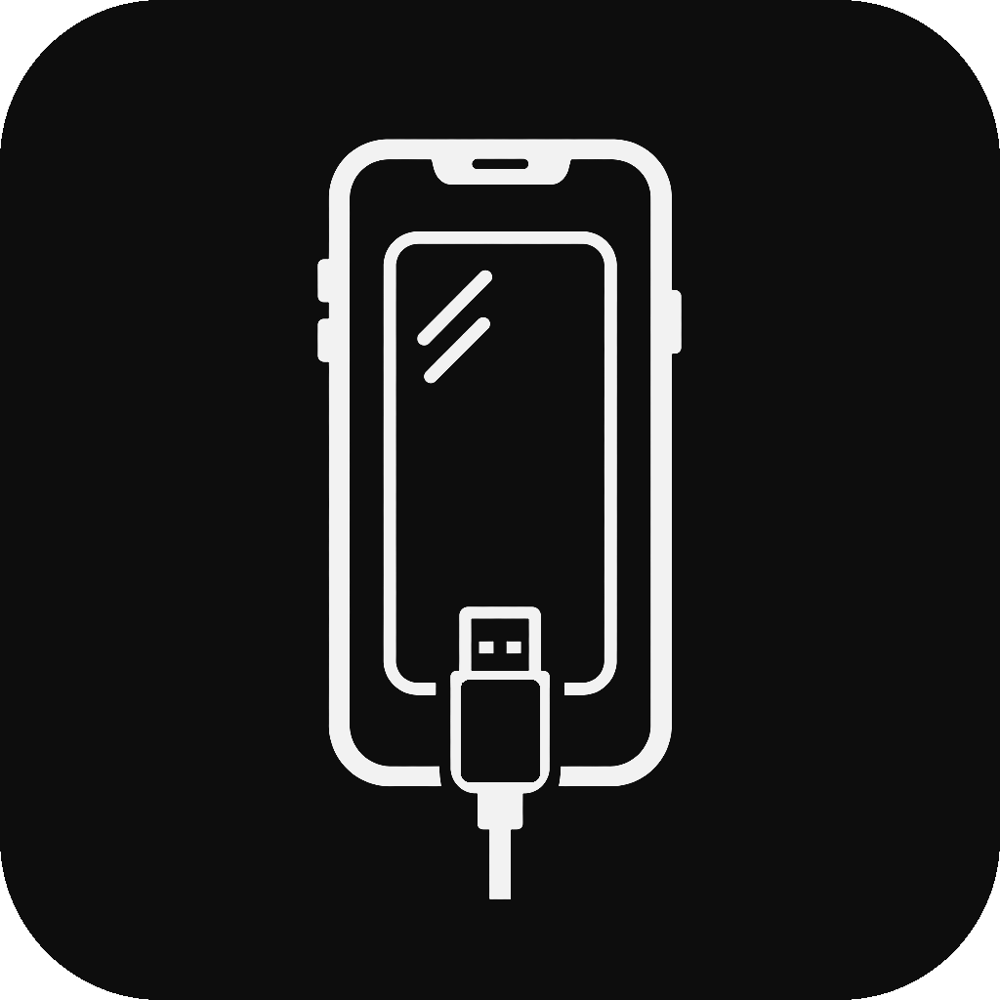
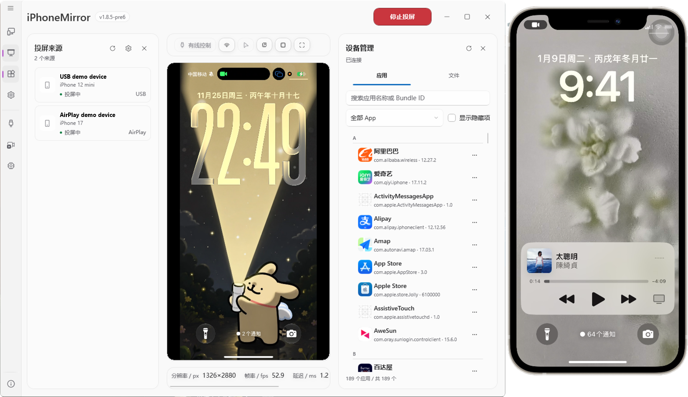
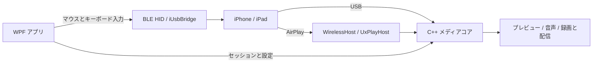

<p align="center">
  
</p>

<h1 align="center">iPhoneMirror</h1>

<p align="center">
  <strong>Windows で iPhone・iPad の画面を映し、操作する。</strong><br>
  USB と AirPlay · システム音声 · 複数デバイス · 録画と配信
</p>

<p align="center">
  <a href="https://github.com/RayrenSX/iPhoneMirror/releases/latest"></a>
  <a href="https://github.com/RayrenSX/iPhoneMirror/releases"></a>
  <a href="https://github.com/RayrenSX/iPhoneMirror/actions/workflows/windows-build.yml"></a>
  <a href="LICENSE"></a>
  <a href="https://qm.qq.com/q/3mQLkBm7gs"></a>
</p>

<p align="center">
  <a href="#ダウンロード">ダウンロード</a> · <a href="#クイックスタート">クイックスタート</a> · <a href="#操作方法と利用条件">操作の条件</a> · <a href="#ソースからビルド">ビルド</a> · <a href="docs/USER_GUIDE.md">ユーザーガイド</a> · <a href="docs/DONATE.md">開発を支援</a>
</p>

<p align="center"><a href="README.md">English</a> · <a href="README.zh-CN.md">简体中文</a> · <strong>日本語</strong></p>


<p align="center"><sub>iPhoneMirror の USB・AirPlay ミラーリング、デバイス管理、独立プレビューの例。</sub></p>

iPhoneMirror は、Windows 向けのオープンソースの iPhone / iPad ミラーリングツールです。USB またはローカルネットワークの AirPlay で画面とシステム音声を PC に取り込み、必要に応じてマウス・キーボード操作、独立ウィンドウ、録画、配信を利用できます。ミラーリングのメディアはローカルで処理し、クラウドを経由しません。

## コミュニティ

QQ グループで使用体験の共有、質問、機能の提案について交流できます。

[**QQ グループ：1050045279**](https://qm.qq.com/q/3mQLkBm7gs)

## ダウンロード

**Windows 10 / 11 x64** · Windows ARM64 は現在未対応 · .NET ランタイムとドライバー管理ツールを同梱

プレビュー版には最近の機能と修正が含まれますが、不具合がある可能性があります。正式版は機能が古い場合があるため、各バージョンのリリースノートをご確認ください。

| 公開区分 | 最新の公開バージョン | ダウンロード |
|---|---|---|
| プレビュー | [v1.8.5-pre6](https://github.com/RayrenSX/iPhoneMirror/releases/tag/v1.8.5-pre6) | [Setup](https://github.com/RayrenSX/iPhoneMirror/releases/download/v1.8.5-pre6/iPhoneMirror-Setup-v1.8.5-pre6-x64.exe) · [ZIP](https://github.com/RayrenSX/iPhoneMirror/releases/download/v1.8.5-pre6/iPhoneMirror-v1.8.5-pre6-win-x64.zip) |
| 正式版 | [v1.8.3](https://github.com/RayrenSX/iPhoneMirror/releases/tag/v1.8.3) | [Setup](https://github.com/RayrenSX/iPhoneMirror/releases/download/v1.8.3/iPhoneMirror-Setup-v1.8.3-x64.exe) · [ZIP](https://github.com/RayrenSX/iPhoneMirror/releases/download/v1.8.3/iPhoneMirror-v1.8.3-win-x64.zip) |

公開バージョンの確認日は **2026-11-26** です。**Setup（推奨）** はウィザードに従ってインストールします。**ZIP（ポータブル版）** はすべて展開し、`iPhoneMirror.exe` を実行してください。[全リリースと公開時の説明](https://github.com/RayrenSX/iPhoneMirror/releases) · [変更履歴](CHANGELOG.md)

ローカルの main は iPhoneMirror 1.8.5 正式版に向けた最後のプレビューです。[v1.8.5-pre7 リリースノート](docs/releases/v1.8.5-pre7.ja-JP.md)

> 公開パッケージには商用コード署名がないため、Windows が SmartScreen や「不明な発行元」の警告を表示する場合があります。iOS 更新により、非公開の USB プロトコルや AirPlay の互換性が変わる可能性があります。利用できる機能は、ダウンロードしたバージョンのリリースノートをご確認ください。

## クイックスタート

以下の手順と機能説明は、ローカルの [v1.8.5-pre7 プレビュー版](docs/releases/v1.8.5-pre7.ja-JP.md) を対象としています。以前のバージョンでは一部の機能を利用できない場合があります。以前の正式版 **v1.8.3** にはセットアップウィザード、キー割り当て、統合デバイス管理がないため、USB または AirPlay の接続手順から始めてください。これらの新機能が必要な場合はプレビュー版を選んでください。

### 初回起動：セットアップウィザードを完了する

初回起動時は、ウィザードに従って基本設定と接続方法を選び、案内に沿ってドライバーの確認、デバイスの関連付け、表示設定の保存を行います。リモート操作を使う場合は、選んだ操作方法の準備も完了してください。スキップした項目は、後から設定でウィザードを開いて続けられます。[初回設定ガイド](docs/FIRST_RUN_SETUP.md)

設定後は、以下の方法で接続して使用します。

### USB で接続

1. iPhoneMirror を起動して iPhone / iPad を USB で接続し、ロックを解除して「このコンピュータを信頼」を選びます。
2. ウィザードでドライバーの準備が済んでいない場合は、左側の「ドライバー」を開き、案内に従って必要なドライバーと Apple USB サポートをインストールします。
3. 「ソース」でデバイスを選び、「ミラーリングを開始」をクリックします。

ドライバーのインストール・修復・削除には同梱の管理ツールを使用してください。**Zadig で Apple 親デバイスのドライバーを置き換えないでください。** 詳細は[ドライバーと接続のガイド](docs/USER_GUIDE.md#安装和管理有线驱动)を参照してください。

### AirPlay で接続

1. PC と iPhone / iPad を同じローカルネットワークに接続し、iPhoneMirror を起動したままにします。
2. iPhone / iPad のコントロールセンターで「画面ミラーリング」を開き、iPhoneMirror の受信先を選びます。

受信名と画質は「設定 → 投影 → 無線AirPlay」で変更できます。受信先が見つからない場合や画面が黒い場合は、[無線接続とファイアウォールの説明](docs/USER_GUIDE.md#airplay-无线投屏)をご確認ください。

## 操作方法と利用条件

ミラーリングとリモート操作は別々に設定します。**画面が映っても操作できるとは限りません。以下の 17.4 要件は USB / ワイヤレスのタッチ操作に適用され、通常の USB / AirPlay ミラーリングの共通要件ではありません。**

### USB / ワイヤレスのタッチ操作

- **iOS / iPadOS 17.4 以降が必要です。** デベロッパモード、対応する開発者イメージ（DDI）、デバイスの HID サービス検証も必要です。バージョン条件を満たしても、すべての機種での動作を保証するものではありません。
- **USB 操作**：ケーブルで接続し、ロックを解除して「このコンピュータを信頼」を選び、アプリの案内に従って準備します。
- **ワイヤレス操作**：デバイスをペアリングし、PC と同じローカルネットワーク上で通信できる状態にします。初回のペアリングや DDI の準備では USB 接続が必要な場合があります。AirPlay の受信先を選んでも、操作用のペアリングは自動では完了しません。
- **キー割り当て**：この 2 種類のタッチ操作専用で、Bluetooth モードには対応しません。[設定と制限](docs/USER_GUIDE.md#有线与无线反向控制) · [キー割り当て](docs/KEYBOARD_MAPPING.md)

### Bluetooth 操作

- **PC の条件**：Windows 10 1809 以降と、BLE ペリフェラルモードに対応する Bluetooth アダプターおよびドライバーが必要です。通常の Bluetooth 接続に対応しているだけでは十分ではありません。
- **端末の条件**：AssistiveTouch のマウス・キーボード入力に対応するシステムが必要です。「設定 → アクセシビリティ → タッチ → AssistiveTouch」を有効にし、案内に従って HID のペアリングとデバイスの関連付けを行います。
- **タッチ操作との違い**：上記の 17.4 要件、デベロッパモード、DDI には依存しません。端末への追加アプリや脱獄は不要です。ポインターとキーボードの操作が中心で、実際のマルチタッチやキー割り当てには対応しません。[Bluetooth の設定と互換性](docs/USER_GUIDE.md#蓝牙反向控制)

## できること

- **スマートフォンをデスクトップで使う**：システム音声を再生し、全画面、最前面表示、透明度、機種別の角丸を備えた独立ウィンドウを配置できます。
- **複数デバイスを同時に表示**：デバイスごとにセッションとウィンドウを持ち、メイン画面を切り替えても他のミラーリングを継続できます。
- **マウスとキーボードで操作**：Bluetooth と USB / ワイヤレス操作、ショートカットに対応。USB / ワイヤレスのタッチ操作ではキー割り当ても利用できます。事前に[操作の利用条件](#操作方法と利用条件)をご確認ください。
- **デモ、録画、配信を作成**：スクリーンショット、録画、RTMP / SRT / WHIP 配信に対応。独立ウィンドウを OBS でキャプチャでき、Windows 11 では仮想カメラも利用できます。[出力ガイド](docs/OBS_OUTPUT.md)
- **デバイス管理と自動化**：アプリやファイルの閲覧、開発者ツールの利用、ローカル HTTP API・Python SDK・MCP によるスクリプト連携ができます。[デバイス管理](docs/DEV_DEVICE_HUB.zh-CN.md) · [自動化](sdk/python/README.md)

## ガイドとヘルプ

詳細ガイドは主に中国語です。

| 目的 | 入口 |
|---|---|
| 操作、利用条件、よくある問題を確認する | [ユーザーガイド](docs/USER_GUIDE.md) |
| キー、録画、配信、OBS を設定する | [キー割り当て](docs/KEYBOARD_MAPPING.md) · [メディア出力](docs/OBS_OUTPUT.md) |
| ローカル API や技術資料を調べる | [HTTP API](docs/api/README.md) · [ドキュメント一覧](docs/README.md) |
| 接続、映像、操作の問題を解決する | [よくある質問](docs/USER_GUIDE.md#常见问题) · [サポートガイド](SUPPORT.md) |

## ソースからビルド

**Windows 10 / 11 x64** で次の開発環境を準備します。

- Visual Studio 2026 Build Tools の C++ デスクトップ開発コンポーネント：MSVC、Windows SDK、CMake 3.25 以降。
- [`global.json`](global.json) で指定する .NET 10 SDK と、操作ブリッジのパッケージ化に使う Python 3.13 x64。
- 既定でビルドする UxPlay オプションコンポーネント向けの MSYS2 UCRT64、GStreamer、libplist、OpenSSL など。パッケージ一覧は [Windows ワークフロー](.github/workflows/windows-build.yml)を参照してください。初回の依存関係の取得にはネット接続が必要です。

PowerShell で実行します。

```powershell
git clone https://github.com/RayrenSX/iPhoneMirror.git
cd iPhoneMirror
./build.ps1 -Configuration Release
```

既定のスクリプトは、ネイティブコアと WPF アプリのビルド、Python ブリッジのパッケージ化、テスト、自己完結型アプリの発行を行います。通常の起動ファイルは `outputs/iPhoneMirror/iPhoneMirror.exe` です。出力ディレクトリ全体を保持してください。

自己完結型アプリを発行せずに Debug ビルドとテストを実行する場合：

```powershell
./build.ps1 -Configuration Debug -NoPublish
```

`-NoPublish` でもネイティブ依存関係とブリッジは準備します。ローカルの WPF ランタイムテストには対話型デスクトップが必要です。引数、インストーラーの作成、個別の検証は[開発とテストのガイド](docs/DEVELOPMENT.md)を参照してください。

## アーキテクチャ

WPF アプリがデバイス、セッション、UI を管理し、C++ コアが音声と映像を処理します。操作は独立した入力経路でデバイスへ送信し、ドライバーの変更は専用の管理ツールが担当します。



| モジュール | 役割 |
|---|---|
| `src/App` | .NET / WPF UI、デバイスのセッション、入力ルーティング、Automation API、更新 |
| `src/Core` | C++20 コア、USB / QuickTime、デコード、D3D11 描画、WASAPI 音声 |
| `src/WirelessHost` / `src/UxPlayHost` | AirPlay / DLNA 受信と UxPlay 代替受信のアダプター。IPC でコアに接続 |
| `tools/usb_touch_bridge.py` / `tools/iostouch` | Python の CoreDevice 操作、DDI 準備、デバイス管理。`iUsbBridge.exe` としてパッケージ化 |
| `src/DriverInstaller` / `src/VirtualCamera` | 独立したドライバー管理ツールと Windows 11 仮想カメラ |
| `src/Shared` / `src/SharedUI` / `sdk/python` | 共有ロジック、UI コンポーネント、Python SDK / MCP |

プロトコル、プロセス間通信、詳細なデータフローは[アーキテクチャガイド](docs/ARCHITECTURE.md)を参照してください。

## プロジェクトへの参加

不具合や機能の提案は [GitHub Issues](https://github.com/RayrenSX/iPhoneMirror/issues) へ。**QQ グループ 1050045279** でも交流できます。ソフトウェア、Windows / iOS のバージョン、接続方法、再現手順を記載し、ログのデバイス識別子や個人情報は伏せてください。

ドキュメントの改善、翻訳、デバイス互換性の報告、具体的な不具合の修正から参加できます。コードを提出する前に[貢献ガイド](CONTRIBUTING.md)をお読みください。ビルド環境と検証方法は[開発とテスト](docs/DEVELOPMENT.md)、モジュール構成は[アーキテクチャ](docs/ARCHITECTURE.md)を参照してください。

セキュリティの脆弱性は[非公開で報告](https://github.com/RayrenSX/iPhoneMirror/security/advisories/new)してください。

## 開発を支援

iPhoneMirror は無料・オープンソースです。開発と保守へのご支援は任意で、すべての機能は無料で利用できます。

[WeChat Pay](docs/DONATE.md#wechat-pay--微信支付) · [Alipay](docs/DONATE.md#alipay--支付宝) · **PayPal：現在利用不可。アカウントの審査待ちです。**

Star、フィードバック、貢献にも感謝します。

## コミュニティ移植版

iPhoneMirror を他のプラットフォームへ移植してくださる開発者に感謝します。各移植版は独立して維持されています。機能、ダウンロード、互換性は各プロジェクトをご確認ください。

| プラットフォーム | メンテナー | プロジェクト |
|---|---|---|
| Linux | [@furruka](https://github.com/furruka) | [リポジトリ](https://github.com/furruka/iPhoneMirror) · [移植の説明](https://github.com/furruka/iPhoneMirror/blob/linux-port/docs/LINUX_PORT.md) |
| HarmonyOS（PC） | [@zhangziqizZ](https://github.com/zhangziqizZ) / Bilibili @Fantasy_zzq | [リポジトリ](https://github.com/zhangziqizZ/iPhoneMirror) · [移植の説明](https://github.com/zhangziqizZ/iPhoneMirror/blob/main/docs/移植说明.md) |

## ライセンスと謝辞

iPhoneMirror のオリジナルコードは [GPL-3.0-only](LICENSE) です。改変版の配布では、GPLv3 のソース提供、著作権表示、同一ライセンスでの配布要件に従ってください。サードパーティのコンポーネントには各ライセンスが適用されます。[サードパーティ通知](THIRD_PARTY_NOTICES.md)を参照してください。

プロトコル調査の参考を提供してくださった [danielpaulus/quicktime_video_hack](https://github.com/danielpaulus/quicktime_video_hack) と [chotgpt/quicktime_video_hack_windows](https://github.com/chotgpt/quicktime_video_hack_windows) に感謝します。

Apple、iPhone、iOS、QuickTime は Apple Inc. の商標です。本プロジェクトは Apple Inc. と提携しておらず、後援や承認も受けていません。
