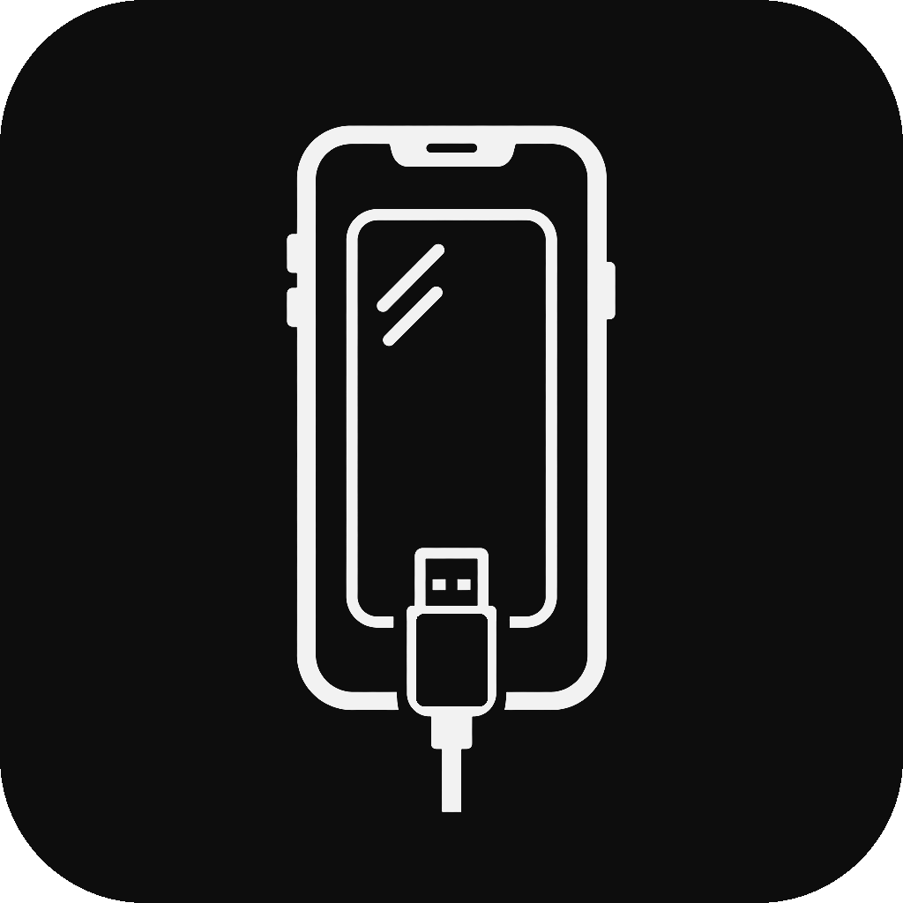
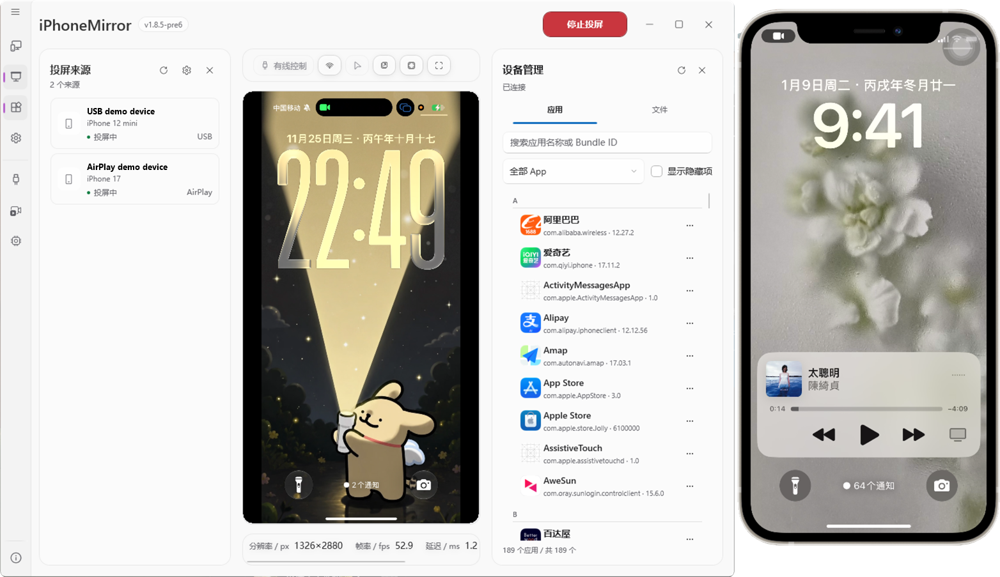
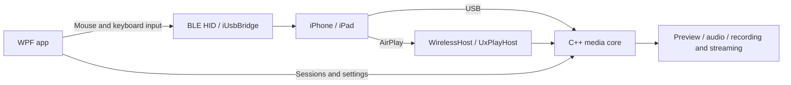

<p align="center">
  
</p>

<h1 align="center">iPhoneMirror</h1>

<p align="center">
  <strong>Mirror and control your iPhone and iPad on Windows.</strong><br>
  USB and AirPlay · System audio · Multiple devices · Recording and streaming
</p>

<p align="center">
  <a href="https://github.com/RayrenSX/iPhoneMirror/releases/latest"></a>
  <a href="https://github.com/RayrenSX/iPhoneMirror/releases"></a>
  <a href="https://github.com/RayrenSX/iPhoneMirror/actions/workflows/windows-build.yml"></a>
  <a href="LICENSE"></a>
  <a href="https://qm.qq.com/q/3mQLkBm7gs"></a>
</p>

<p align="center">
  <a href="#download">Download</a> · <a href="#quick-start">Quick start</a> · <a href="#control-methods-and-requirements">Control requirements</a> · <a href="#build-from-source">Build</a> · <a href="docs/en/USER_GUIDE.md">User guide</a> · <a href="docs/en/DONATE.md">Support</a>
</p>

<p align="center"><strong>English</strong> · <a href="README.zh-CN.md">简体中文</a> · <a href="README.ja.md">日本語</a></p>


<p align="center"><sub>USB and AirPlay mirroring, device management, and an independent preview in iPhoneMirror.</sub></p>

iPhoneMirror is an open-source iPhone / iPad mirroring tool for Windows. Connect over USB or local-network AirPlay to bring video and system audio to your computer, then add mouse and keyboard control, independent windows, recording, or streaming as needed. Mirroring media is processed locally, with no cloud relay.

## Community

Join our QQ group to share your experience, ask questions, and discuss feature ideas.

[**QQ group: 1050045279**](https://qm.qq.com/q/3mQLkBm7gs)

## Download

**Windows 10 / 11 x64** · Windows ARM64 currently unsupported · .NET runtime and driver manager included

Preview includes recent features and fixes and may have issues. Stable may have an older feature set; check the release notes before choosing.

| Public channel | Latest published version | Download |
|---|---|---|
| Preview | [v1.8.5-pre6](https://github.com/RayrenSX/iPhoneMirror/releases/tag/v1.8.5-pre6) | [Setup](https://github.com/RayrenSX/iPhoneMirror/releases/download/v1.8.5-pre6/iPhoneMirror-Setup-v1.8.5-pre6-x64.exe) · [ZIP](https://github.com/RayrenSX/iPhoneMirror/releases/download/v1.8.5-pre6/iPhoneMirror-v1.8.5-pre6-win-x64.zip) |
| Stable | [v1.8.3](https://github.com/RayrenSX/iPhoneMirror/releases/tag/v1.8.3) | [Setup](https://github.com/RayrenSX/iPhoneMirror/releases/download/v1.8.3/iPhoneMirror-Setup-v1.8.3-x64.exe) · [ZIP](https://github.com/RayrenSX/iPhoneMirror/releases/download/v1.8.3/iPhoneMirror-v1.8.3-win-x64.zip) |

Public versions verified on **2026-11-26**. **Setup (recommended)** installs the app through a wizard. For the **portable ZIP**, extract the entire archive and run `iPhoneMirror.exe`. [All releases and release notes](https://github.com/RayrenSX/iPhoneMirror/releases) · [Changelog](CHANGELOG.md)

The local main build is the final preview before iPhoneMirror 1.8.5. [v1.8.5-pre7 release notes](docs/en/RELEASE_NOTES.md)

> Packages are not commercially code-signed; Windows may show SmartScreen or unknown-publisher warnings. iOS updates may affect USB private-protocol and AirPlay compatibility. Check your downloaded version's release notes for available features.

## Quick start

The steps and feature descriptions below cover the local [v1.8.5-pre7 preview](docs/en/RELEASE_NOTES.md). Older builds may omit some of these features. The older stable release **v1.8.3** does not include the setup wizard, key mapping, or integrated device management; on that version, start with the USB or AirPlay steps below. Choose the preview release if you need these newer features.

### First launch: complete the setup wizard

On your first launch, follow the setup wizard to choose your preferences and connection method, complete the prompted driver checks and device binding, and save your display settings. Configure the control method you intend to use. If you skip a step, reopen the wizard from Settings to finish it later. [Setup guide](docs/en/USER_GUIDE.md#first-launch-and-setup)

After setup, use one of the connection methods below.

### Connect over USB

1. Open iPhoneMirror, connect your iPhone / iPad by USB, unlock it, and choose **Trust This Computer**.
2. If the setup wizard has not prepared the drivers, open **Drivers** in the left sidebar and install the required drivers and Apple USB support as prompted.
3. Select the device under **Sources** and click **Start mirroring**.

Use the included driver manager to install, repair, and remove drivers. **Do not replace the Apple parent-device driver with Zadig.** See the [driver and connection guide](docs/en/USER_GUIDE.md#install-and-manage-usb-drivers) if you need help.

### Connect over AirPlay

1. Connect the computer and iPhone / iPad to the same local network and leave iPhoneMirror running.
2. Open **Screen Mirroring** in the phone's Control Center and select the iPhoneMirror receiver.

Change the receiver name and quality under **Settings → Projection → Wireless AirPlay**. Receiver missing or screen black? See [wireless setup and firewall guidance](docs/en/USER_GUIDE.md#wireless-airplay).

## Control methods and requirements

Mirroring and control are configured separately. **A working mirror does not guarantee control support. The 17.4 requirement below applies to USB / wireless touch control, not to ordinary USB / AirPlay mirroring.**

### USB / wireless touch control

- **Requires iOS / iPadOS 17.4 or later.** Developer Mode, a matching developer disk image (DDI), and successful device HID-service validation are also required. The OS version alone does not guarantee compatibility with every device.
- **USB control**: Connect by cable, unlock the device, choose **Trust This Computer**, and follow the app's preparation prompts.
- **Wireless control**: Pair the device and keep it reachable on the same local network. Initial pairing or DDI preparation may require a USB connection. Selecting the AirPlay receiver does not automatically pair the control connection.
- **Key mapping**: Available only with these two touch-control methods; Bluetooth mode is unsupported. [Setup and limitations](docs/en/USER_GUIDE.md#usb-and-wi-fi-touch-control) · [Key mapping](docs/en/USER_GUIDE.md#key-mapping)

### Bluetooth control

- **Computer**: Windows 10 1809 or later, with a Bluetooth adapter and driver supporting BLE Peripheral role. Ordinary Bluetooth connectivity alone is not sufficient.
- **Phone or tablet**: A system supporting AssistiveTouch mouse / keyboard input. Enable **Settings → Accessibility → Touch → AssistiveTouch**, then complete HID pairing and device binding as prompted.
- **How it differs**: Does not depend on the 17.4 threshold above, Developer Mode, or a DDI; no extra phone app or jailbreak is needed. It provides pointer and keyboard input, without true multi-touch or key mapping. [Bluetooth setup and compatibility](docs/en/USER_GUIDE.md#bluetooth-control)

## What you can do

- **Keep your phone on your desktop**: Play system audio and arrange independent windows with fullscreen, always-on-top, opacity, and device-specific screen corners.
- **View several devices at once**: Each device has its own session and window. Other sessions can keep running when you switch the main preview.
- **Use your mouse and keyboard**: Bluetooth and USB / wireless control with shortcuts; USB / wireless touch control also supports key mapping. Check the [control requirements](#control-methods-and-requirements) before setup.
- **Create demos, recordings, and streams**: Capture screenshots, record, or stream over RTMP / SRT / WHIP. Use a clean independent window in OBS, or a virtual camera on Windows 11. [Output guide](docs/en/USER_GUIDE.md#recording-streaming-and-obs)
- **Manage devices and automate tasks**: Browse apps and files, use developer tools, or connect scripts through the local HTTP API, Python SDK, and MCP. [Device management](docs/en/USER_GUIDE.md#device-management) · [Automation](sdk/python/README.md)

## Guides and help

Detailed guides are mostly in Chinese.

| Your goal | Start here |
|---|---|
| Learn workflows, requirements, and common fixes | [User guide](docs/en/USER_GUIDE.md) |
| Configure keys, recording, streaming, or OBS | [Key mapping](docs/en/USER_GUIDE.md#key-mapping) · [Media output](docs/en/USER_GUIDE.md#recording-streaming-and-obs) |
| Connect to the local API or explore technical docs | [HTTP API](docs/api/README.md) · [Documentation index](docs/en/README.md) |
| Resolve connection, video, or control problems | [FAQ](docs/en/USER_GUIDE.md#troubleshooting) · [Support guide](SUPPORT.md) |

## Build from source

Prepare a **Windows 10 / 11 x64** development environment:

- Visual Studio 2026 Build Tools with C++ desktop development components: MSVC, Windows SDK, and CMake 3.25 or later.
- .NET 10 SDK as specified by [`global.json`](global.json), and Python 3.13 x64 for packaging the control bridge.
- MSYS2 UCRT64 with GStreamer, libplist, OpenSSL, and related dependencies for the optional UxPlay component built by default. See the [Windows workflow](.github/workflows/windows-build.yml) for the package list. Initial dependency restoration requires internet access.

Run in PowerShell:

```powershell
git clone https://github.com/RayrenSX/iPhoneMirror.git
cd iPhoneMirror
./build.ps1 -Configuration Release
```

The default script builds the native core and WPF app, packages the Python bridge, runs tests, and publishes a self-contained application. The standard entry point is `outputs/iPhoneMirror/iPhoneMirror.exe`; keep the entire output directory together.

For a Debug build and tests without publishing a self-contained app:

```powershell
./build.ps1 -Configuration Debug -NoPublish
```

`-NoPublish` still prepares native dependencies and the bridge. Local WPF runtime tests require an interactive desktop. See the [development and testing guide](docs/en/DEVELOPMENT.md) for switches, installer packaging, and focused validation.

## Architecture

The WPF app manages devices, sessions, and UI. The C++ core processes audio and video, while a separate input path sends control back to the device. Driver changes are handled by the standalone driver manager.



| Module | Responsibility |
|---|---|
| `src/App` | .NET / WPF UI, device sessions, input routing, Automation API, and updates |
| `src/Core` | C++20 core, USB / QuickTime, decoding, D3D11 rendering, and WASAPI audio |
| `src/WirelessHost` / `src/UxPlayHost` | AirPlay / DLNA reception and the UxPlay fallback adapter, connected to the core over IPC |
| `tools/usb_touch_bridge.py` / `tools/iostouch` | Python CoreDevice control, DDI preparation, and device management, packaged as `iUsbBridge.exe` |
| `src/DriverInstaller` / `src/VirtualCamera` | Standalone driver manager and Windows 11 virtual-camera components |
| `src/Shared` / `src/SharedUI` / `sdk/python` | Shared logic and UI components, plus the Python SDK / MCP |

See the [architecture guide](docs/en/ARCHITECTURE.md) for protocols, process communication, and detailed data flow.

## Get involved

Report bugs and suggest features through [GitHub Issues](https://github.com/RayrenSX/iPhoneMirror/issues), or join **QQ group 1050045279** to discuss the app. Include the app version, Windows / iOS versions, connection type, and reproduction steps. Redact device identifiers and personal information from logs.

Contributions can start with documentation, translations, device compatibility reports, or a focused bug fix. Read the [contribution guide](CONTRIBUTING.md) before sending code. See [development and testing](docs/en/DEVELOPMENT.md) for the build environment and validation, and [architecture](docs/en/ARCHITECTURE.md) for the modules.

Report security vulnerabilities [privately](https://github.com/RayrenSX/iPhoneMirror/security/advisories/new).

## Support development

iPhoneMirror is free and open source. Donations are optional and support development and maintenance; all features remain free.

[WeChat Pay](docs/en/DONATE.md#wechat-pay) · [Alipay](docs/en/DONATE.md#alipay) · **PayPal: temporarily unavailable — account review pending.**

Stars, feedback, and contributions are appreciated too.

## Community ports

Thanks to the developers bringing iPhoneMirror to more platforms. These ports are independently maintained; see each project for features, downloads, and compatibility.

| Platform | Maintainer | Project |
|---|---|---|
| Linux | [@furruka](https://github.com/furruka) | [Repository](https://github.com/furruka/iPhoneMirror) · [Port notes](https://github.com/furruka/iPhoneMirror/blob/linux-port/docs/LINUX_PORT.md) |
| HarmonyOS (PC) | [@zhangziqizZ](https://github.com/zhangziqizZ) / Bilibili @Fantasy_zzq | [Repository](https://github.com/zhangziqizZ/iPhoneMirror) · [Port notes](https://github.com/zhangziqizZ/iPhoneMirror/blob/main/docs/移植说明.md) |

## License and acknowledgments

iPhoneMirror's original code is licensed under [GPL-3.0-only](LICENSE). Distributing modified versions requires compliance with GPLv3 source, notice, and same-license distribution obligations. Third-party components retain their own licenses; see [third-party notices](THIRD_PARTY_NOTICES.md).

Thanks to [danielpaulus/quicktime_video_hack](https://github.com/danielpaulus/quicktime_video_hack) and [chotgpt/quicktime_video_hack_windows](https://github.com/chotgpt/quicktime_video_hack_windows) for protocol research references.

Apple, iPhone, iOS, and QuickTime are trademarks of Apple Inc. This project is not affiliated with, sponsored by, or endorsed by Apple Inc.
