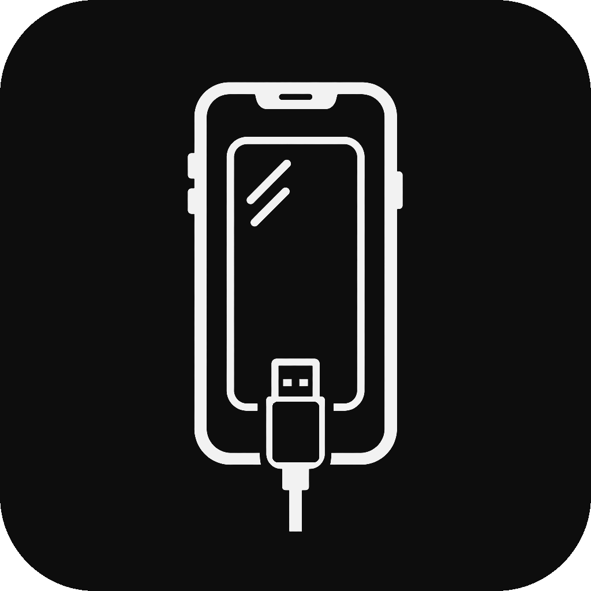
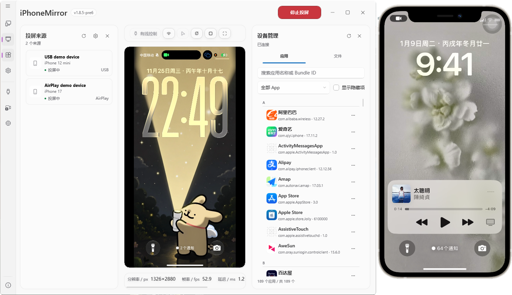
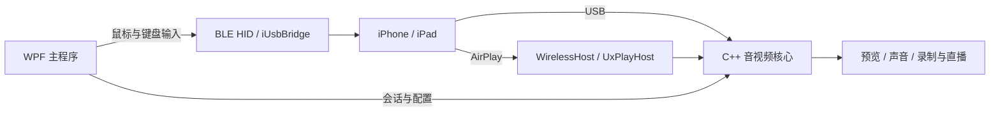

<p align="center">
  
</p>

<h1 align="center">iPhoneMirror</h1>

<p align="center">
  <strong>在 Windows 上投屏与操作你的 iPhone、iPad。</strong><br>
  USB 与 AirPlay · 系统声音 · 多设备 · 录制与直播
</p>

<p align="center">
  <a href="https://github.com/RayrenSX/iPhoneMirror/releases/latest"></a>
  <a href="https://github.com/RayrenSX/iPhoneMirror/releases"></a>
  <a href="https://github.com/RayrenSX/iPhoneMirror/actions/workflows/windows-build.yml"></a>
  <a href="LICENSE"></a>
  <a href="https://qm.qq.com/q/3mQLkBm7gs"></a>
</p>

<p align="center">
  <a href="#下载">下载</a> · <a href="#快速开始">快速开始</a> · <a href="#反控方式与使用条件">反控条件</a> · <a href="#从源码构建">源码构建</a> · <a href="docs/USER_GUIDE.md">使用教程</a> · <a href="docs/zh-CN/DONATE.md">支持项目</a>
</p>

<p align="center"><a href="README.md">English</a> · <strong>简体中文</strong> · <a href="README.ja.md">日本語</a></p>


<p align="center"><sub>iPhoneMirror 的 USB 与 AirPlay 投屏、设备管理和独立预览演示。</sub></p>

iPhoneMirror 是一款开源的 Windows iPhone / iPad 投屏工具。用数据线连接，或通过局域网 AirPlay 投屏，让手机画面与系统声音进入电脑；再按需要开启鼠标键盘控制、独立窗口、录制和直播。投屏媒体在本机处理，无云端中转。

## 社区交流

欢迎加入 QQ 群，与其他用户交流使用体验、反馈问题、讨论功能建议。

[QQ群号：**1050045279**](https://qm.qq.com/q/3mQLkBm7gs)

## 下载

**Windows 10 / 11 x64** · 暂不支持 Windows ARM64 · 内置 .NET 运行时与驱动管理器

预览版包含近期功能与修复，可能存在问题；正式版功能可能较旧，选择前可查看对应版本的发布说明。

| 公开通道 | 最新公开版本 | 下载 |
|---|---|---|
| 预览版 | [v1.8.5-pre6](https://github.com/RayrenSX/iPhoneMirror/releases/tag/v1.8.5-pre6) | [Setup](https://github.com/RayrenSX/iPhoneMirror/releases/download/v1.8.5-pre6/iPhoneMirror-Setup-v1.8.5-pre6-x64.exe) · [ZIP](https://github.com/RayrenSX/iPhoneMirror/releases/download/v1.8.5-pre6/iPhoneMirror-v1.8.5-pre6-win-x64.zip) |
| 正式版 | [v1.8.3](https://github.com/RayrenSX/iPhoneMirror/releases/tag/v1.8.3) | [Setup](https://github.com/RayrenSX/iPhoneMirror/releases/download/v1.8.3/iPhoneMirror-Setup-v1.8.3-x64.exe) · [ZIP](https://github.com/RayrenSX/iPhoneMirror/releases/download/v1.8.3/iPhoneMirror-v1.8.3-win-x64.zip) |

公开版本核对日期为 **2026-11-26**。推荐下载 **Setup（安装版）**，按向导安装；**ZIP（便携版）** 需完整解压后运行 `iPhoneMirror.exe`。[全部版本与发布说明](https://github.com/RayrenSX/iPhoneMirror/releases) · [更新记录](docs/releases/README.md)

本地 main 当前为 1.8.5 正式发布前的最后一个预览版。[v1.8.5-pre7 发布说明](docs/zh-CN/RELEASE_NOTES.md)

> 发布包尚未进行商业代码签名，Windows 可能显示 SmartScreen 或“未知发布者”提示。iOS 更新可能影响 USB 私有协议与 AirPlay 兼容性；具体功能以所下载版本的发布说明为准。

## 快速开始

以下步骤与功能说明以本地 [v1.8.5-pre7 预览版](docs/zh-CN/RELEASE_NOTES.md) 为基准。较早的版本可能缺少部分功能。较早的正式版 **v1.8.3** 不包含首次设置向导、键位映射或集成设备管理；使用该版本时，直接按下方 USB 或 AirPlay 步骤连接。需要这些新功能，请选择预览版。

### 首次启动：跟随设置向导完成配置

首次打开程序时，先跟随设置向导选择基础偏好与连接方式，按提示检查驱动、完成设备绑定并保存显示设置；需要反控时，完成对应控制方式的准备。跳过的项目可稍后从设置中重新打开向导继续配置。[首次设置说明](docs/FIRST_RUN_SETUP.md)

完成设置后，再按以下方式开始使用。

### 使用数据线

1. 启动 iPhoneMirror，用数据线连接 iPhone / iPad，解锁并选择“信任此电脑”。
2. 如果设置向导尚未完成驱动准备，打开左侧“驱动”，按提示安装所需驱动和 Apple USB 支持。
3. 在“投屏来源”中选择设备，点击“开始投屏”。

驱动安装、修复和卸载请使用随包附带的驱动管理器，**不要用 Zadig 替换 Apple 父设备驱动**。遇到问题可查看[驱动与连接教程](docs/USER_GUIDE.md#安装和管理有线驱动)。

### 使用 AirPlay

1. 让电脑与 iPhone / iPad 连接到同一局域网，并保持 iPhoneMirror 运行。
2. 在手机控制中心打开“屏幕镜像”，选择 iPhoneMirror 接收端。

接收端名称和画质可在“设置 → 投屏 → 无线 AirPlay”调整。找不到接收端或连接后黑屏？查看[无线连接与防火墙说明](docs/USER_GUIDE.md#airplay-无线投屏)。

## 反控方式与使用条件

投屏和反控分别配置。**能投屏不代表能反控；下述 17.4 版本要求针对 USB / 无线触控反控，不是普通 USB / AirPlay 投屏的统一门槛。**

### USB / 无线触控反控

- **系统要求：iOS / iPadOS 17.4 及以上。** 还需开启开发者模式，准备与系统匹配的开发者镜像（DDI），并通过设备 HID 服务验证。达到版本要求不代表所有机型和系统组合都能使用。
- **USB 有线反控**：使用数据线连接，解锁设备并“信任此电脑”，按程序提示完成准备。
- **无线反控**：设备需完成配对，与电脑处于同一局域网且保持可达。首次配对或准备开发者镜像时，可能需要先连接 USB；在 AirPlay 中选中接收端不会自动完成反控配对。
- **键位映射**：仅支持这两种触控反控方式，蓝牙模式不支持。[配置步骤与限制](docs/USER_GUIDE.md#有线与无线反向控制) · [键位映射](docs/KEYBOARD_MAPPING.md)

### 蓝牙反控

- **电脑要求**：Windows 10 1809 及以上，蓝牙适配器及驱动支持 BLE 外设模式（Peripheral role）。仅支持普通蓝牙连接，不代表支持此功能。
- **手机要求**：系统支持辅助触控鼠标 / 键盘，在“设置 → 辅助功能 → 触控 → 辅助触控”中开启辅助触控，并按提示完成 HID 配对和设备绑定。
- **与触控反控的区别**：不依赖上述 17.4 门槛、开发者模式或 DDI；无需在手机安装额外 App 或越狱。主要提供鼠标指针和键盘操作，不支持真正的多指触控，也不支持键位映射。[蓝牙配置与兼容条件](docs/USER_GUIDE.md#蓝牙反向控制)

## 你可以用它做什么

- **把手机放在桌面上用**：播放系统声音，用独立窗口、全屏、置顶和透明度安排工作区；按机型适配屏幕圆角。
- **同时查看多台设备**：每台设备独立会话、独立窗口，切换主预览时其他投屏可继续运行。
- **用鼠标键盘操作手机**：支持蓝牙与 USB / 无线反控、快捷键；USB / 无线触控反控还可配置键位映射。使用前请查看[反控条件](#反控方式与使用条件)。
- **制作演示、录制与直播**：直接截图、录制或通过 RTMP / SRT / WHIP 推流；干净的独立窗口可交给 OBS 采集，Windows 11 还可使用虚拟摄像头。[输出指南](docs/OBS_OUTPUT.md)
- **管理设备、编写自动化**：浏览应用与文件，使用开发者工具；通过本地 HTTP API、Python SDK 和 MCP 接入脚本。[设备管理](docs/DEV_DEVICE_HUB.zh-CN.md) · [自动化接入](docs/zh-CN/SDK.md)

## 使用与帮助

| 你的需求 | 入口 |
|---|---|
| 查看完整操作、兼容条件与常见问题 | [使用教程](docs/USER_GUIDE.md) |
| 设置键位、录制、推流与 OBS | [键位映射](docs/KEYBOARD_MAPPING.md) · [媒体输出](docs/OBS_OUTPUT.md) |
| 接入本地 API 或查阅技术资料 | [HTTP API](docs/zh-CN/AUTOMATION.md) · [文档索引](docs/README.md) |
| 连接失败、黑屏或反控无响应 | [常见问题](docs/USER_GUIDE.md#常见问题) · [问题反馈指南](docs/zh-CN/SUPPORT.md) |

## 从源码构建

在 **Windows 10 / 11 x64** 上准备：

- Visual Studio 2026 Build Tools 的 C++ 桌面开发组件：MSVC、Windows SDK、CMake 3.25 及以上。
- .NET 10 SDK，具体版本与滚动策略见 [`global.json`](global.json)；Python 3.13 x64 用于打包反控桥接器。
- MSYS2 UCRT64 及 GStreamer、libplist、OpenSSL 等依赖，用于默认构建的 UxPlay 可选组件；完整包清单见 [Windows 构建工作流](.github/workflows/windows-build.yml)。首次还原依赖需要联网。

在 PowerShell 中执行：

```powershell
git clone https://github.com/RayrenSX/iPhoneMirror.git
cd iPhoneMirror
./build.ps1 -Configuration Release
```

默认脚本会编译原生核心与 WPF 应用、打包 Python 桥接器、运行测试，并生成自包含程序。常规输出入口为 `outputs/iPhoneMirror/iPhoneMirror.exe`，请保留整个输出目录。

调试构建与测试（不生成自包含发布目录）：

```powershell
./build.ps1 -Configuration Debug -NoPublish
```

`-NoPublish` 仍会准备原生依赖和桥接器；本地 WPF 运行时测试需要交互桌面。更多参数、安装包打包和专项验证见[开发与测试指南](docs/DEVELOPMENT.md)。

## 项目架构

WPF 主程序管理设备、会话与界面，C++ 核心负责音视频处理，反控通过独立输入通道返回设备。驱动变更由独立驱动管理器执行。



| 模块 | 职责 |
|---|---|
| `src/App` | .NET / WPF 界面、多设备会话、输入路由、自动化 API 与更新 |
| `src/Core` | C++20 核心、USB / QuickTime、解码、D3D11 渲染与 WASAPI 音频 |
| `src/WirelessHost` / `src/UxPlayHost` | AirPlay / DLNA 接收与 UxPlay 备用接收适配，通过 IPC 接入核心 |
| `tools/usb_touch_bridge.py` / `tools/iostouch` | Python CoreDevice 反控、DDI 准备与设备管理，打包为 `iUsbBridge.exe` |
| `src/DriverInstaller` / `src/VirtualCamera` | 独立驱动管理器与 Windows 11 虚拟摄像头组件 |
| `src/Shared` / `src/SharedUI` / `sdk/python` | 共享逻辑与界面组件，以及 Python SDK / MCP |

协议、进程通信和完整数据流见[架构说明](docs/ARCHITECTURE.md)。

## 参与项目

欢迎通过 [GitHub Issues](https://github.com/RayrenSX/iPhoneMirror/issues) 反馈问题和提出建议，也可以加入 **QQ群 1050045279** 交流使用体验。反馈时请带上软件版本、Windows / iOS 版本、连接方式和复现步骤，日志中的设备标识与个人信息请先脱敏。

贡献可以从改进文档、翻译、报告设备兼容性或修复一个具体问题开始。提交代码前请阅读[贡献指南](docs/zh-CN/CONTRIBUTING.md)；构建环境和验证方法见[开发与测试](docs/DEVELOPMENT.md)，模块关系见[架构说明](docs/ARCHITECTURE.md)。

安全漏洞请通过[私密漏洞报告](https://github.com/RayrenSX/iPhoneMirror/security/advisories/new)提交。

## 支持项目

iPhoneMirror 免费开源。欢迎自愿赞赏，支持后续开发与维护；捐赠不影响任何功能的使用。

[微信支付](docs/zh-CN/DONATE.md#微信支付) · [支付宝](docs/zh-CN/DONATE.md#支付宝) · **PayPal：暂不可用，账户正在等待审核。**

也感谢你的 Star、反馈和贡献。

## 社区移植

感谢社区开发者把 iPhoneMirror 带到更多平台。以下版本由各自作者独立维护，功能、下载与兼容性以对应项目为准。

| 平台 | 维护者 | 项目 |
|---|---|---|
| Linux | [@furruka](https://github.com/furruka) | [仓库](https://github.com/furruka/iPhoneMirror) · [移植说明](https://github.com/furruka/iPhoneMirror/blob/linux-port/docs/LINUX_PORT.md) |
| HarmonyOS（鸿蒙 PC） | [@zhangziqizZ](https://github.com/zhangziqizZ) / B站 @Fantasy_zzq | [仓库](https://github.com/zhangziqizZ/iPhoneMirror) · [移植说明](https://github.com/zhangziqizZ/iPhoneMirror/blob/main/docs/移植说明.md) |

## 许可与致谢

iPhoneMirror 自有代码采用 [GPL-3.0-only](LICENSE)。分发修改版时，请遵守 GPLv3 的源码提供、版权声明和同许可证分发要求。第三方组件遵循各自许可证，详见[第三方声明](docs/zh-CN/THIRD_PARTY_NOTICES.md)。

感谢 [danielpaulus/quicktime_video_hack](https://github.com/danielpaulus/quicktime_video_hack) 和 [chotgpt/quicktime_video_hack_windows](https://github.com/chotgpt/quicktime_video_hack_windows) 提供的协议研究参考。

Apple、iPhone、iOS、QuickTime 是 Apple Inc. 的商标。本项目与 Apple Inc. 无隶属、赞助或认可关系。
