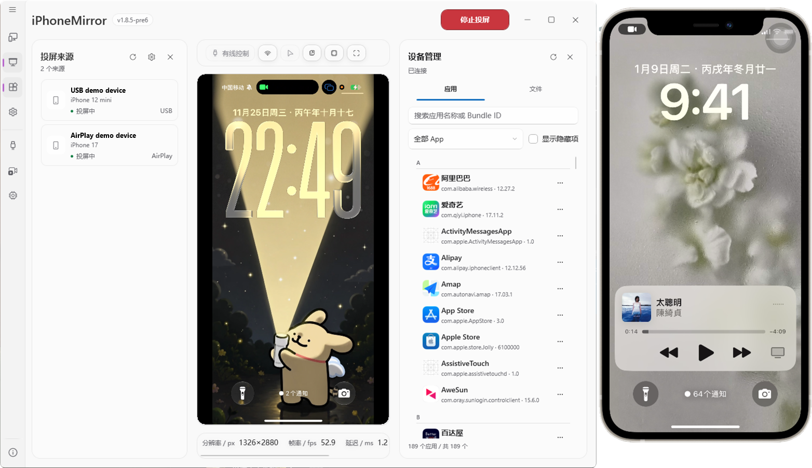

# iPhoneMirror 使用指南

[文档索引](README.md) · [English user guide](en/USER_GUIDE.md)

本指南使用本地 main 的 v1.8.5-pre7 界面名称。这是 1.8.5 正式发布前的最后一个预览版。较早版本的入口和功能可能不同。[pre7 发布说明](zh-CN/RELEASE_NOTES.md)

## 从这里开始

| 你想做什么 | 阅读位置 |
|---|---|
| 第一次使用 | [安装](#安装更新与卸载) → [首次设置](#首次启动与设置向导) |
| 用数据线投屏 | [驱动准备](#安装和管理有线驱动) → [USB 投屏](#usb-有线投屏) |
| 不插线投屏 | [AirPlay 无线投屏](#airplay-无线投屏) |
| 用鼠标键盘操作手机 | [选择反控方式](#选择反控方式) |
| 安排多个投屏窗口 | [设备列表](#多设备与设备排序) · [独立窗口](#独立窗口与全屏) |
| 截图、复制文字或传文件 | [预览工具](#画面声音和预览工具) |
| 录制或接入 OBS | [输出、直播与录制](#输出直播与录制) |
| 浏览手机应用和文件 | [设备管理](#管理应用与文件) |
| 查看设备日志、模拟定位或管理描述文件 | [高级设备工具](#高级设备工具) |
| 连接失败、黑屏或没有声音 | [常见问题](#常见问题) |

## 使用前确认

- 电脑使用 **Windows 10 / 11 x64**，暂不支持 Windows ARM64。发布包已包含 .NET 运行时。
- 普通 USB 投屏需要支持数据传输的线缆、设备信任及正确驱动；AirPlay 需要手机与电脑位于同一局域网。
- **USB／无线触控反控需要 iOS／iPadOS 17.4 及以上**，以及开发者模式、匹配的开发者镜像和可用的设备服务。版本满足不代表所有机型都能反控。
- **蓝牙反控**需要支持 BLE 外设模式的电脑蓝牙适配器和手机辅助触控，不依赖上述开发者镜像；不能执行键位映射或真正的多指触控。
- 普通投屏与反控是两项功能。能看见画面，不代表已经可以用鼠标键盘操作手机。

## 安装、更新与卸载

### 标准安装

本节的下载步骤适用于已公开的安装包。本地源码构建请参阅[开发指南](DEVELOPMENT.md#常用构建)。

1. 从 [Releases](https://github.com/RayrenSX/iPhoneMirror/releases) 下载需要的版本，优先选择 `iPhoneMirror-Setup-v*-x64.exe`。
2. 运行安装程序，选择安装目录，完成后从开始菜单启动。
3. 若选择便携版 ZIP，先完整解压，再运行 `iPhoneMirror.exe`。请保留整个目录，不要只复制 EXE 或单个 DLL。

当前发布包尚未进行商业代码签名，Windows 可能显示 SmartScreen 或“未知发布者”。下载来源和文件完整性可通过同一 Release 的 `SHA256SUMS.txt` 核对。

### 自动更新

在左侧「关于」检查更新。发现新版本后，先阅读更新说明，再点击「立即更新」；下载校验完成后，程序会启动安装并重新打开应用。

「关于 → 更新设置」可以调整启动检查、自动下载、正式版／Beta 提醒和下载线路。检查失败不影响正常使用。

### 卸载

在 Windows「设置 → 应用」中卸载。卸载向导会询问是否删除用户设置和下载缓存；希望以后保留配置时选择保留。需要清理有线驱动时，使用程序附带的驱动管理器。

## 首次启动与设置向导

首次启动先跟随向导完成准备：

1. 选择语言，阅读免费开源说明，再按提示选择应用模式、主题和使用方式。
2. 按提示连接设备、解锁并信任电脑，检查有线驱动。
3. 将同一台手机的 USB、无线和蓝牙身份绑定到同一个设备档案；只配置当前需要的连接方式即可。
4. 若需要反控，完成对应的配对、辅助触控或开发者模式准备。
5. 选择显示偏好，保存并进入主界面。

完整向导的免费开源说明显示满 3 秒后可继续，后面的作者支持页可以直接跳过。暂时没有设备时也可以先跳过对应配置。从「设置 → 应用」中的初始配置入口可继续。

完成向导后，仍需按下面的步骤开始投屏。仅通过设置检查不代表已经建立投屏或反控连接。

## 认识主界面

- **投屏来源**：选择当前设备、刷新列表、绑定设备或调整卡片显示。
- **中央预览**：显示当前设备；右上角「开始投屏／停止投屏」控制当前来源。
- **顶部工具栏**：常用反控、独立窗口、截图和全屏入口；鼠标悬停图标可查看名称。
- **底部状态栏**：当前分辨率、帧率、延迟和音频状态。
- **设备管理**：在画面右侧浏览当前设备的应用和文件。
- **设置**：分为「应用」「投屏」「反控」三类，各设置组直接显示。
- **输出、驱动、关于**：分别用于录制直播、有线驱动维护、版本更新与诊断。

### 设置分类

| 分类 | 常用内容 |
|---|---|
| 应用 | 语言、主题、完整／轻量／托盘模式、隐藏说明与状态栏、顶部工具栏、网络代理、初始配置 |
| 投屏 | 有线协议、无线接收、画质、解码器、声音、独立窗口启动布局 |
| 反控 | 自动连接、快捷键、键位映射、鼠标方向和蓝牙鼠标参数 |

先选中设备，再修改它的专属设置。分辨率、帧率和解码器修改后自动保存；无线接收设置仍需点击「应用」。其他带有「应用」或「完成」的编辑页，按页面提示提交。

### 自定义顶部工具栏

在「设置 → 应用」点击「自定义顶部工具栏」，也可以右键工具栏进入。

1. 按住按钮拖动排序，选中按钮后可隐藏。
2. 从「组件库」添加工具，例如录制与推流、调节画面、复制画面文字、发送文件。
3. 按需开启「仅图标」，点击「完成」保存；「取消」恢复本次编辑前的布局。

默认显示有线控制、无线控制、蓝牙控制、独立窗口、截图、全屏预览。「恢复默认」可找回这些按钮。

## 安装和管理有线驱动

AirPlay 无线投屏不需要安装 USB 采集驱动。

### 一键安装

1. 用数据线连接手机，保持解锁并信任电脑。
2. 打开左侧「驱动」，确认选中的是要使用的设备。
3. 点击「一键安装全部驱动」，按提示完成管理员授权。
4. 按工具提示重新插拔设备，再回到主程序开始投屏。

工具会检查并补齐 Apple USB 支持和当前设备的采集驱动。主程序发现有线驱动异常时，也会打开驱动管理器。

**不要用 Zadig 把 Apple 父设备替换为 WinUSB／libusb。** 驱动安装、修复和卸载统一通过附带的管理器处理。

### 高级驱动页面

只有一键安装未解决问题时，再使用高级页面检查、修复或卸载。操作前核对设备名称；涉及驱动重装时，遵循工具给出的拔插顺序。失败时先保存错误信息和日志，避免反复更换父设备驱动。

## USB 有线投屏

### 连接步骤

1. 连接数据线，解锁手机并选择「信任此电脑」。
2. 打开「投屏来源」，选择设备；未显示时点击刷新。
3. 首次使用先完成[驱动准备](#一键安装)。
4. 点击右上角「开始投屏」。看到画面后，可按需打开声音、反控或独立窗口。
5. 结束时点击「停止投屏」。程序清理完成后再拔线；该设备的有线反控也会随有线投屏结束。

### 有线模式

开始投屏前，在「设置 → 投屏」选择协议。模式按设备保存。运行中先停止投屏再切换。升级时，原来保存的固定尺寸 C 模式会切换到 AirPlay 模式。

| 模式 | 何时使用 |
|---|---|
| **AirPlay 模式（推荐）** | 新设备的默认选择，保留真实状态栏，自动适配横竖屏；视频 App 可尝试外接播放 |
| **演示模式（兼容）** | 推荐模式不能正常显示时尝试；状态栏日期、时间和电量会变成 Apple 演示值，不支持视频 App 的 AirPlay 外接播放 |

有线设置中的「AirPlay 模式」仍然通过数据线投屏，不是 Wi-Fi 连接。视频 App 的外接画面可能受自身规则影响，出现裁切或比例差异；每个模式旁的说明按钮可查看限制。

## AirPlay 无线投屏

### 连接前设置接收端

1. 让电脑和手机连接到同一可信局域网，启动 iPhoneMirror。
2. 打开「设置 → 投屏 → 无线 AirPlay」。首次使用可保留原始方案和默认的 1080p 档位。
3. 按需修改接收端名称和画质，然后点击「应用」。

| 画质 | 适合场景 |
|---|---|
| 原画／对应机型面板尺寸 | 优先保留细节，网络和电脑负担较大 |
| 1080p | 日常投屏的默认选择 |
| 720p／540p | 网络较差或希望降低负担 |

原画档是接收能力，实际分辨率和帧率由手机决定。修改接收方案、名称、画质或端口会重启接收端，断开现有无线投屏，需要在手机上重新连接。

原始方案连接不正常时，可尝试「UxPlay（备用）」。首次使用按提示下载组件；UxPlay 用于屏幕镜像，不提供视频 App 的 URL／DLNA 投放。RAOP 端口通常保持默认，只有提示占用时才修改。

### 在 iPhone/iPad 上连接

1. 打开手机「控制中心 → 屏幕镜像」。
2. 选择接收端，默认名称为 `iPhoneMirror AirPlay`。
3. 连接成功后，电脑会显示无线设备及画面，无需先在电脑上点击「开始投屏」。
4. 在电脑点击「停止投屏」，或在手机控制中心停止镜像，即可结束。

防火墙弹出网络访问提示时，按所用可信网络允许接收程序通信。安装版的管理员安装会配置本地子网规则；便携版若连接失败，请查看[无线连接排查](#无线列表找不到-iphonemirror)。

### 已配对设备的无线投屏

设备卡片显示「已配对 · 无线在线」，表示电脑发现了以前配对的设备，尚未开始投屏。

在 pre7 中选中该设备后点击「开始投屏」，使用 **CoreDevice 投屏**，需要 **iOS／iPadOS 27 及以上**、设备绑定、开发者模式和匹配的开发者镜像。目前该方式只提供画面；不满足条件时，使用手机控制中心的普通 AirPlay 或 USB 投屏。

这与 17.4 及以上的无线反控要求不同，不能因为无线反控可用就认为 CoreDevice 投屏也可用。准备条件见[无线发现说明](PAIRED_WIRELESS_DISCOVERY.md)。

## 多设备与设备排序

- 点击设备卡片切换主预览，其他已启动的会话可继续运行；每台设备可打开独立窗口。
- 同一台设备已绑定的 USB、Wi-Fi 和 AirPlay 身份会合并为一张卡片。同名设备仍需通过绑定器确认，不能只靠名称识别。
- 按住卡片片刻后拖动可排序；列表右上角齿轮可选择图标、名称、型号、系统版本、状态和连接方式等显示内容，也可恢复默认。
- 右键卡片可复制设备信息，或创建直接打开该设备投屏窗口的桌面快捷方式。重启、关机会要求确认并中断设备连接。
- 多台高分辨率设备会增加电脑和网络负担；出现卡顿时，先降低无线画质或减少同时显示的窗口。

### 设备档案与绑定

打开左侧「设备绑定器」，选中或添加设备档案，再分别绑定它的 USB、AirPlay 和蓝牙身份。无线投屏身份需要先在手机上开始 AirPlay；蓝牙按窗口提示连接后确认所属手机。

档案列表的右键菜单可重命名、删除档案，各连接方式也可单独「解绑」。绑错设备时先解绑再选正确设备；删除档案会解除其中全部身份绑定，重新使用时需要再次绑定。

## 选择反控方式

反控是用电脑向手机发送鼠标、触控或键盘输入。先选中正确设备，再开启对应控制方式。

| 方式 | 必要条件 | 键位映射 |
|---|---|---|
| USB 有线触控 | iOS／iPadOS **17.4+**，数据线、信任、开发者模式、匹配开发者镜像、设备服务可用 | 支持 |
| 无线触控 | iOS／iPadOS **17.4+**，完成配对、同一局域网、开发者模式、匹配开发者镜像、设备服务可用 | 支持 |
| 蓝牙 | 支持 BLE 外设模式的电脑适配器及驱动、手机辅助触控和 HID 配对 | 不支持 |

### 有线与无线反向控制

1. 选择手机，点击工具栏「有线控制」或「无线控制」。按钮隐藏时可从工具栏组件库添加。
2. 按连接窗口提示完成设备档案绑定。有线方式需解锁并信任电脑；无线方式需先完成配对，同一局域网内能互相访问。
3. 按提示在手机「设置 → 隐私与安全性 → 开发者模式」中开启开发者模式，重启并确认。程序会准备匹配的开发者镜像；首次准备或签名可能需要联网。
4. 等待连接成功，再点击预览中的目标位置进行操作。首次无线配对或镜像准备可能需要先连接 USB。
5. 使用同一控制入口关闭连接。

仅在 AirPlay 列表中选择电脑，不会自动完成无线反控配对。17.4 是最低系统条件，设备服务验证失败时仍无法反控，应按错误提示排查。

### 鼠标、键盘与触摸屏操作

- 在预览中左键点击、按住拖动或滚轮滚动，操作当前设备；需要输入文字时先点选手机上的输入框。
- USB／无线触控支持 Windows 触摸屏，主预览、独立窗口和全屏最多同时操作五个触点；鼠标、触摸和键位映射共享这个额度。蓝牙不提供五点触控。
- 回到桌面、打开多任务、控制中心、通知中心、Dock、Siri、锁屏与音量等操作，可在「设置快捷键」绑定；是否可执行取决于当前控制通道和设备能力。

### 蓝牙反向控制

电脑需要 Windows 10 1809 及以上，并且蓝牙适配器及驱动支持 **BLE 外设模式（Peripheral role）**。能连接蓝牙耳机不代表支持该模式。

1. 选择目标设备，点击「蓝牙控制」。
2. 在手机「设置 → 辅助功能 → 触控 → 辅助触控」开启辅助触控，按提示配对电脑广播的 HID 设备。
3. 在程序绑定窗口中确认客户端属于这台手机，连接成功后再操作预览。
4. 默认相对鼠标模式下，按 `F9` 暂停并释放鼠标，再按一次恢复。可在快捷键设置中更改。

蓝牙方式无需开发者模式、开发者镜像、额外手机 App 或越狱；主要是单指指针和键盘操作，不支持真正的多指触控或键位映射。

「设置 → 反控」中的「蓝牙绝对位置（实验）」可让鼠标直接点选画面位置，默认关闭。切换前需完全停止蓝牙控制；若提示刷新配对，在手机忽略旧 HID 设备后重新配对。它仍受辅助触控和系统兼容性限制。

### 自动连接、方向和文字输入

- 在「设置 → 反控」选择「投屏时自动开启反向控制」，后续投屏成功时尝试所选方式。手动关闭后不会循环重连；选择「关闭」只关闭自动启动。
- 点击或滑动方向不正确时，调整「鼠标方向」中的竖屏／横屏方向和反转选项，再点击「应用方向设置」。蓝牙灵敏度在自己的分组中应用。
- 电脑输入法候选结果不会自动变成手机文字。有线／无线方式需要发送已输入的中文时，可复制文字，在手机输入框获得焦点后尝试 `Ctrl+V`；手机可能要求允许粘贴。纯蓝牙不提供这条文字通道。
- 有线／无线控制中，在手机上选中文字后按 `Ctrl+C`，可请求复制并读回电脑剪贴板。手机或 App 禁止复制时仍不可用；复制画面上的非选中文字请使用[文字识别](#截图与复制画面文字)。
- 「设置 → 反控 → 键盘与快捷键」可切换「手机输入法：显示／隐藏」。默认保留手机原生输入法，隐藏后仍可用电脑键盘输入；适用于有线／无线控制，已连接时尝试立即应用，未连接时在下次开启控制后生效。

### 键位映射

先连接 USB／无线触控反控，再进入「设置 → 反控 → 键盘映射 → 管理键盘映射」。

1. 添加映射，录入一个按键。
2. 选择点击、长按、按住直到松开、双击或滑动。
3. 在投屏画面中选择位置或录制滑动，确认并完成。
4. 启用映射，点击预览使其获得焦点，再按绑定键。

每条映射可单独开关、编辑、删除；可选择是否阻止已映射普通按键的原始 Windows 行为。编辑映射或操作文字输入框时，映射会暂停。蓝牙模式不执行这些动作。完整步骤见[键位映射](KEYBOARD_MAPPING.md)。

## 画面、声音和预览工具

### 调整画质

在「设置 → 投屏」调整渲染分辨率、帧率和解码器，修改后自动保存。

- **原生**保留细节；较低的本地渲染分辨率和帧率可降低电脑负担，但不会重新降低 USB 源视频的传输质量。
- 解码器优先保留「自动（推荐）」。出现解码异常时再尝试「软件兼容」；硬件路径是否可用取决于电脑和驱动。
- 「色彩与亮度」可调亮度、对比度、饱和度和 Gamma，实时预览，点击「保存」保留；返回或关闭会恢复本次修改前的值，也可重置默认值。它只改变本地预览效果，不改变截图、录制、推流和虚拟摄像头的内容。
- 无线源的连接画质在 [AirPlay 设置](#连接前设置接收端)中调整，修改后需重新连接。

画面停住时可用「刷新画面」或 `Ctrl+R` 请求刷新；它与重新扫描设备的 `F5` 不同。

### 声音

在「设置 → 投屏 → 投屏声音输出」选择输出方式。

- **Windows**：在电脑默认播放设备上播放手机声音，可调播放音量或静音。
- **仅手机**：适用的有线来源可请求把声音留在手机。电脑此时无法采集手机声音用于录制或直播；有输出任务时先结束任务再切换。
- **AirPlay**：音频去向由手机播放设置控制，电脑端可调整收到的声音。更详细的采集及缓冲说明见 [WASAPI 音频](WASAPI_AUDIO.md)。
- **音画同步／播放缓冲**：低缓冲延迟更小，高缓冲可减少断音；开启音画同步会按缓冲短暂延迟预览。

多设备可在各独立窗口右键菜单中分别静音，也可静音其他窗口。

### 截图与复制画面文字

- 点击「截图」选择路径，将当前画面保存为 PNG，不包含应用按钮和窗口边框；没有有效画面时会提示无法截图。
- 点击「复制画面文字」，或聚焦预览后按 `Alt+C`。画面定格后拖选文字，按 `Ctrl+C` 或「复制所选」；按 `Esc` 返回实时画面。
- 文字识别在电脑执行，识别语言依赖 Windows OCR 语言包。按钮未显示时，从工具栏组件库添加。

### 发送文件与安装 IPA

先为目标设备开启有线／无线反控。点击「发送文件」，或从资源管理器拖入文件到主预览／独立窗口，确认目标 App 后发送到它开放的共享文档目录。

仅投屏或蓝牙反控不足以传文件。App 没有开放共享文档时不会出现在可用目标中；上传文件不会自动导入 iOS「照片」图库。

拖入 IPA 后先选择「传文件」或「安装」。安装可使用现有签名，或按窗口选择 Apple ID、P12／PFX、证书与私钥等方式签名；核对设备与文件后点击安装。取消不会移除已经安装成功的 App，签名仍需满足 Apple 的设备和账号许可。[详细安装说明](IPA_INSTALL.md)

## 独立窗口与全屏

点击「独立窗口」，将当前设备放到不带主界面面板的预览窗口中。

- 拖动可移动区域调整位置，拖边缘等比例缩放；需要移动窗口时先取消固定，若鼠标正用于手机反控，再暂停控制。
- 双击、`F11` 或 `Alt+Enter` 切换全屏，`Esc` 退出全屏。
- 右键菜单可设置置顶、固定窗口、旋转、圆角、手机边框、声音和窗口样式。
- 独立窗口的右键「反向控制」菜单也可切换控制方式，无需先返回主窗口。关闭窗口后，主预览仍在使用的会话会保留；独立窗口单独启动且未由主预览使用的会话可能随之结束。要明确结束设备会话，使用「停止投屏」。

### 手机边框与机身颜色

在「设置 → 投屏」或独立窗口的「窗口 → 样式」开启手机边框。该开关全局保存，并应用到受支持的独立窗口；全屏时自动隐藏。机型不受支持时，以页面提示为准。

自动识别的机身颜色不准确时，在投屏设置中选择当前设备的「机身颜色」。屏幕圆角可从独立窗口的「显示」菜单切换；旋转显示不会修改手机本身的方向设置。

### 记住窗口位置

在「设置 → 投屏 → 独立窗口启动布局」选择：

| 方式 | 打开时的行为 |
|---|---|
| 按上次布局打开 | 默认，恢复该设备上次的位置、大小和固定状态 |
| 自动布局 | 由程序安排位置和大小 |
| 使用预设布局 | 使用该设备已保存的预设；先摆好窗口，再点击「将当前窗口保存为预设」 |
| 自定义 | 填写位置和大小，输入框失焦或按回车保存 |

模式修改自动保存，下次打开独立窗口时生效，不会立即移动当前窗口。缺少对应布局时使用自动安排。

### 透明度与鼠标穿透

右键「窗口 → 样式」可调整透明度和「鼠标悬停时不透明」。透明度低于 80% 时可开启「鼠标穿透」，让鼠标操作下面的应用，投屏继续显示。

**恢复交互：按 `Ctrl+Alt+Shift+P`，或从系统托盘选择「恢复窗口交互」。** 穿透时不能直接点击窗口；恢复后再进入样式设置取消穿透或提高透明度。

### 独立窗口快捷键

「设置 → 反控 → 设置快捷键」可为透明度、置顶、悬停不透明和手机边框添加快捷键，选择「点击切换」或「按住临时切换」；也可绑定录制、截图、全屏、窗口静音、左右旋转和固定窗口等动作。这些窗口快捷键不要求开启手机反控。

同一窗口中的「独立窗口中的 Windows 热键」可设置「放行到 Windows」或「拦截」。点击输入框录入按键组合，或手动逐行填写；未列出的按键沿用原行为。它控制电脑热键去向，不会自动创建手机触控映射。

## 输出、直播与录制

先开始投屏，再打开左侧「输出」或工具栏「录制与推流」。

### 录制视频

1. 选择录制，检查分辨率、帧率与码率；默认尺寸来自当前预览。
2. 点击「开始录制」。
3. 点击「停止录制」，封装完成后选择 MP4 保存位置。

取消保存不会立即丢弃录像，可稍后重新打开输出窗口保存；不需要的待保存录像可点「丢弃录制」。当前录制页不提供麦克风选择，需要解说可使用 OBS 录制。切换设备输出前先停止当前任务。

### 直播推流

选择 RTMP、SRT 或 WHIP，填写直播平台提供的地址；WHIP 需要鉴权时填写 Bearer 令牌，再开始直播。地址和令牌不要出现在公开截图或日志中。

需要解说时，在直播页选择麦克风，默认关闭；插入新设备后点击刷新麦克风列表。麦克风混音需要可用的音频管线，启用它不改变手机声音在本地的播放方式。

同一来源可同时运行一路录制和一路直播，分别停止；「停止输出」结束全部输出。两路输出会增加电脑负担。

需要手机声音时，将有线声音输出设为 Windows。源音频可用时一同输出；没有可用源音轨，且直播未选择麦克风时，可输出纯视频。

### OBS 与虚拟摄像头

**窗口采集：**

1. 为目标设备打开独立窗口。
2. 在 OBS 添加「窗口采集」，选择对应的 iPhoneMirror 设备窗口。
3. 捕获方法优先选 Windows Graphics Capture，再调整画面尺寸。
4. 需要声音时，选择桌面音频或应用程序音频捕获，避免对同一声音重复采集造成回声。

**虚拟摄像头：** 需要 Windows 11，首次安装按提示授予管理员权限。选择输出尺寸和帧率并启动后，在会议软件或 OBS 中选择 `iPhoneMirror Virtual Camera`。它只提供视频，声音需另行采集；虚拟摄像头与内建录制／直播不能同时使用。不再使用时，可从该页卸载虚拟摄像头。[更多输出设置](OBS_OUTPUT.md)

## 管理应用与文件

### 连接设备管理

1. 在「投屏来源」选择设备，打开左侧「设备管理」。
2. 已有连接可直接复用；未连接时点击「启用反控并连接」，按提示完成绑定与准备。
3. 等待连接成功，使用「应用」或「文件」页。仅打开面板不会替你完成设备授权。

### 应用

按名称或 Bundle ID 搜索，可筛选用户、系统、开发、轻 App，并按需显示隐藏项。双击或按 Enter 打开 App，右键或行内「…」可关闭、复制 Bundle ID 或卸载。卸载会删除应用及相应数据，请核对所选设备和 App 后确认。

切换筛选为「进程」，可按名称、路径或 PID 搜索，复制 PID 或结束所选进程。「以 Metal 性能 HUD 重启」会关闭并重新启动所选 App，请先保存内容；仅支持的 App 会显示性能浮层，普通打开不启用 HUD。

### 文件与资源管理器

- 选择可访问的媒体目录、App 文档或崩溃报告目录，双击进入文件夹。
- 「导入文件」上传到当前目录；「另存为」下载到电脑。重名导入会保留副本，崩溃报告等只读目录不能上传。
- 普通文件的「…」菜单可复制路径、确认后删除文件；文件夹不通过该操作递归删除。崩溃报告可从「更多」菜单导出。
- 路径栏可输入目录，Backspace／`Alt+↑` 返回上级；目录内容较多时点击「加载更多」。`F5` 刷新当前页。
- 开启「映射到资源管理器」，用 Windows 盘符访问当前设备允许开放的目录，在有写入权限的目录中复制、改名、新建或删除。其他目录可能逐步出现，等待发现完成后刷新；跨服务或跨应用移动不受支持，可改用复制。
- 部分目录只读，不代表设备所有文件都能访问；不包含未经授权的应用数据或 iCloud 云盘。Windows 属性设置不能解除手机的只读限制。
- 关闭映射、设备断线或退出程序后映射会清理。复制失败时留意页面显示的单文件大小限制。

设备信息、描述文件、日志、手机控制等高级操作位于「开发者工具 → 设备工具」。需要时连续点击「关于」版本号五次开启开发者入口。[设备管理详细说明](DEV_DEVICE_HUB.zh-CN.md)

### 高级设备工具

打开「开发者工具 → 设备工具」，先确认左侧选中的是正确设备，再完成连接。这里复用已有的设备授权和控制连接。

| 页面／操作 | 用法与限制 |
|---|---|
| 信息 | 查看并复制设备、系统、电池、存储和可用能力信息 |
| 应用 | 浏览应用与进程；标题栏「更多」可安装 IPA，仍需有效签名与设备许可 |
| 描述文件 | 查看、安装或移除配置／预置描述文件；配置安装还需在手机上确认 |
| 日志 | 点击开始读取手机实时日志，可筛选、跟随、停止和保存；与「关于」中的电脑端程序日志不同 |
| 控制：手机按键 | 回到桌面、打开多任务、锁屏和调节音量 |
| 控制：手机设置 | 先读取支持项，再修改并逐项应用；可用项包括外观、文字大小和辅助功能，手机不支持的项不显示 |
| 控制：模拟定位 | 输入纬度、经度后应用；结束时点击恢复定位，避免继续影响依赖位置的 App |
| 控制：电源 | 睡眠、重启或关机；重启和关机会确认，并中断当前连接 |

## AirPlay 音乐投放

在手机音乐 App 或控制中心的播放面板中点击 AirPlay 音频按钮，选择 iPhoneMirror 接收端。无需打开「屏幕镜像」。

电脑显示「AirPlay 音乐」时只有音频，截图和全屏等视频工具不可用；可正常调音量或停止投放。

## 视频应用投屏

使用默认的原始接收方案，在支持的手机视频 App 内点击投屏按钮，选择 iPhoneMirror 接收端。电脑会进入视频播放界面。

这与控制中心的屏幕镜像不同。受 DRM、登录态或 App 私有协议限制的内容可能不能播放；仅某个 App 播放失败时，先尝试普通屏幕镜像。UxPlay 不提供此功能。

播放界面提供暂停／继续、前后跳转、进度、音量和全屏控制，实际能否控制取决于来源 App。

## 应用模式与托盘常驻

在「设置 → 应用 → 应用模式」选择：

- **完整模式**：保留完整工作区；可分别隐藏描述、工具栏和状态栏。
- **轻量模式**：减少界面元素，主要查看投屏画面。
- **托盘模式**：主窗口隐藏，从 Windows 托盘选择设备、打开独立窗口或停止投屏。

启用「关闭主界面时进入托盘模式」后，关闭主窗口仍保留连接和独立窗口。从托盘选择「恢复主界面」返回；要结束全部会话，选择「退出应用」。

### 老板键

在「设置快捷键」配置「老板键（隐藏／显示窗口）」，默认 `Ctrl+Alt+B`，以保存的绑定为准。按下后隐藏应用窗口，再按同一组合键恢复；隐藏期间手机输入和键位映射会暂停。它只能绑定键盘，避免隐藏后无法用鼠标恢复。

### 网络代理

在「设置 → 应用 → 网络代理」选择默认网络设置、不使用代理或手动 HTTP 代理。手动填写形如 `http://127.0.0.1:7897` 的地址，不含账号、密码或路径，点击「保存代理设置」后重启应用生效。仅影响本应用，不会替手机配置代理。

## 语言与快捷键

界面语言和主题在「设置 → 应用」修改。工具提示可帮助识别仅显示图标的按钮。

下列预览快捷键通常需要主窗口或独立预览获得焦点；编辑文本、设置或映射时，部分按键交给当前编辑页面处理。

| 快捷键 | 操作 |
|---|---|
| `F11`／`Esc` | 进入／退出全屏 |
| `Alt+Enter` | 切换独立窗口全屏 |
| `Ctrl+Shift+P` | 打开独立窗口 |
| `Ctrl+S` | 截图 |
| `Alt+C` | 选择画面文字，随后 `Ctrl+C` 复制 |
| `Ctrl+M` | 静音／恢复 |
| `Ctrl+R` | 刷新画面 |
| `F5` | 刷新设备；设备管理内用于刷新当前页 |
| `Ctrl+Alt+Shift+P` | 恢复所有鼠标穿透窗口的交互 |

反控、老板键、系统导航及窗口样式快捷键在「设置 → 反控 → 设置快捷键」查看或修改，以实际保存的绑定为准。

点击对应输入框录入组合键；支持的操作也可绑定鼠标右键、中键或侧键。可筛选「仅已绑定」，逐项恢复默认或清除绑定，最后点击「保存」。重复、保留或不支持的组合会在窗口中提示。

## 常见问题

### 有线设备能看到，但点击开始后黑屏

1. 确认数据线可传输数据、手机已解锁并信任电脑。
2. 在驱动管理器选择正确设备，完成一键安装／修复后按提示拔插。
3. 使用 AirPlay 模式（推荐）；仍异常时，停止投屏再尝试演示模式（兼容）、其他线缆或 USB 端口。
4. 若主屏幕正常、仅打开特定视频 App 黑屏，可能是受保护内容。回到普通界面验证，软件不能解除内容保护。

### 无线列表找不到 iPhoneMirror

确认手机与电脑在同一局域网，避开互相隔离的访客网络；检查接收端是否就绪，以及防火墙是否允许无线接收程序通信。名称或方案变更后点击「应用」，再在手机上重新打开屏幕镜像列表。

### 无线连接后黑屏、断开或卡顿

- 能发现但连接后很快断开：先检查防火墙是否允许接收程序的 TCP／UDP 通信，不能只放行少数固定端口。无需关闭整个防火墙。
- 卡顿：先改为 720p／540p 后重新连接，改善 Wi-Fi 信号或减少同时投屏设备。
- 旋转后停住：先在手机停止镜像，再连接原接收端；必要时尝试 UxPlay。
- 接收端名称未更新：点击「应用」后等待片刻，手机停止旧会话再搜索。

### 无线组件提示“损坏的映像”或 0xc0e90002

优先使用官方 Setup。便携版需从原 ZIP 属性中解除锁定后重新完整解压，不要只替换一个 DLL；可先保留原目录以免丢失文件。若文件哈希不匹配，重新下载。组织管理的电脑可能需要管理员确认组件运行策略。

### 没有声音、声音断续或录制没有音轨

检查 Windows 音量混合器和默认播放设备，确认程序没有静音。有线来源选择「Windows」而非「仅手机」；AirPlay 在手机播放面板检查输出目标。断音时尝试提高播放缓冲。虚拟摄像头本身没有音轨，需另外捕获声音。

### 有线或无线反向控制无输入

核对 iOS／iPadOS 17.4+、开发者模式、设备信任、镜像准备和当前控制对象。无线还需配对及网络可达。按错误提示重新准备连接；不要把“画面已连接”当作反控已就绪。

### 蓝牙无法连接，或鼠标被接管

检查适配器是否支持 BLE 外设模式、辅助触控是否开启、绑定客户端是否属于当前手机。提示描述符或配对需要刷新时，在手机忽略旧设备再配对。相对鼠标模式用已配置的释放键暂停，默认 `F9`。

### 独立窗口点不到，或热键总在电脑上触发

穿透窗口按 `Ctrl+Alt+Shift+P` 或从托盘恢复交互。电脑热键冲突时，检查「设置快捷键 → 独立窗口中的 Windows 热键」；手机键位映射还要求 USB／无线触控就绪及预览焦点。

### OBS 捕获黑屏

先确认独立窗口有正常画面，再选择该窗口并使用 Windows Graphics Capture。多显卡电脑让 OBS 与 iPhoneMirror 使用同一块 GPU。

### 文件看不到、不能写入或传输失败

先确认设备管理连接可用、目标 App 开放了共享文档。只读目录不能写入，某些系统／App 数据不允许访问；映射仍在发现时等待刷新。大文件失败时检查 Windows 传输大小限制，普通文件也可尝试通过「发送文件」发送到共享文档。

## 诊断与问题反馈

打开左侧「关于」，在「诊断」区域查看、暂停或复制实时日志，也可打开日志目录。常用主程序日志位于 `%LOCALAPPDATA%\iPhoneMirror\Logs`，驱动界面日志位于 `%LOCALAPPDATA%\iPhoneMirror.Driver\Logs\driver-ui.log`。

「清空视图」只清理当前显示；需要释放磁盘空间时使用「清理日志和更新缓存」，先保存准备反馈的记录。「关于」还提供更新日志、许可证和作者支持入口；捐赠完全自愿，入口见[支持作者](zh-CN/DONATE.md)。

反馈请从「关于」复制完整软件版本，并注明本地构建、安装版或便携版。请一并提供 Windows／iOS 版本、设备型号、连接方式、复现步骤和发生时间，并附时间附近的日志。先遮挡电话号码、通知、账号、设备标识、密钥和配对记录。[问题反馈](zh-CN/SUPPORT.md)

也可加入 [QQ群 1050045279](https://qm.qq.com/q/3mQLkBm7gs) 交流。不要反复修改驱动或清空设备档案来代替排查。

## 自动化控制与调试（HTTP API）

需要脚本或 AI 客户端接入时，先完成设备连接和授权，再在开发者工具中启用本地 API、配置密钥。仓库已提供 [Python SDK 和 stdio MCP 服务](zh-CN/SDK.md)，接入步骤见 [HTTP API 文档](zh-CN/AUTOMATION.md)。

自动化页可复制服务地址和密钥、重新生成密钥、打开接口文档，并调整端口及截图频率。自动化输入需要独占控制；结束后释放，也可在程序中收回设备控制。连接自动化客户端前确认截图、剪贴板和设备数据的使用范围。

## 高级 USB 设置

在「设置 → 投屏 → 高级设置」可填写 USB 请求宽高并点击「应用」；恢复自动尺寸时点击「关闭高级模式」。它与本地渲染分辨率上限不同，错误尺寸可能导致黑屏、裁切或需要重新插拔，普通使用保留默认值即可。

兼容性说明见[协议与配置说明](PROTOCOL.md)，开发和编译请查看[开发指南](DEVELOPMENT.md)。
